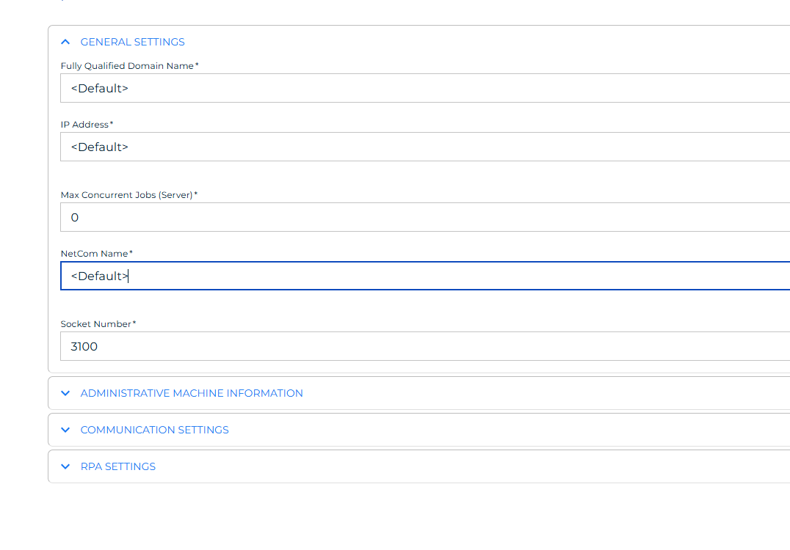
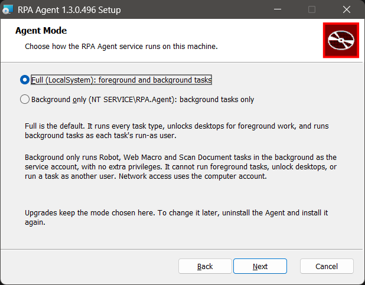
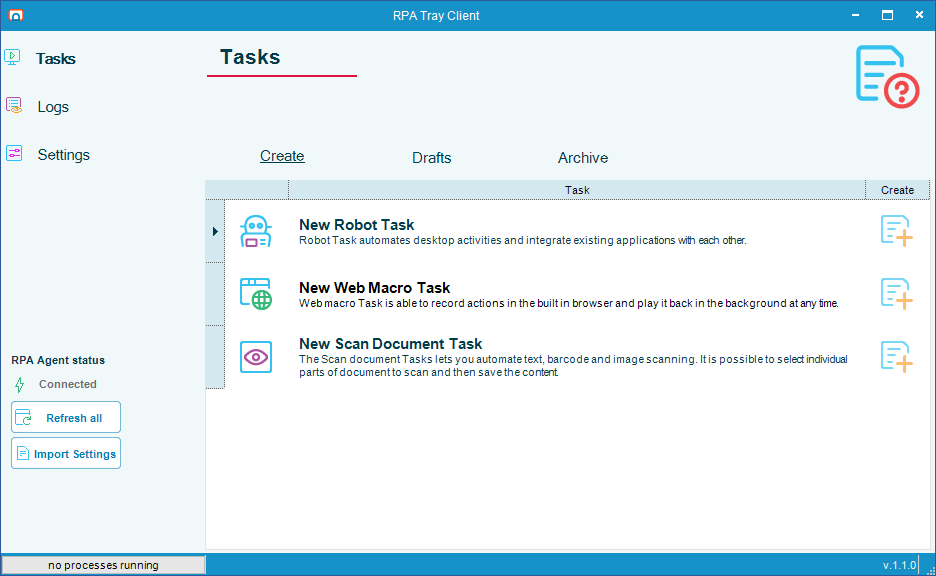
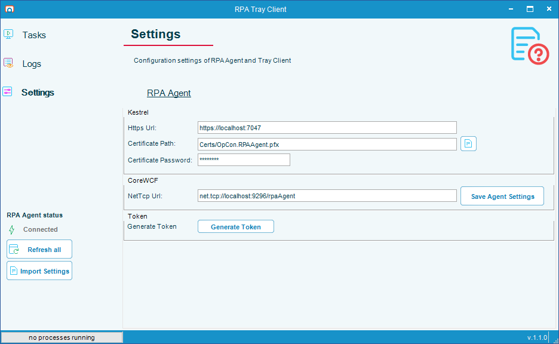
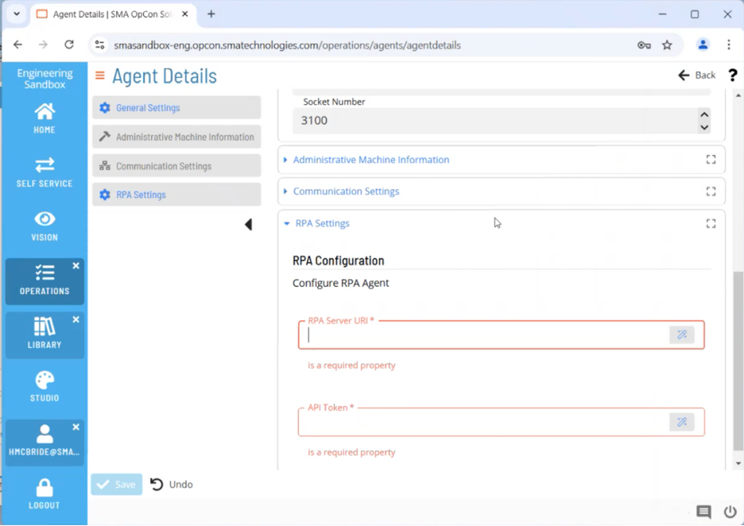
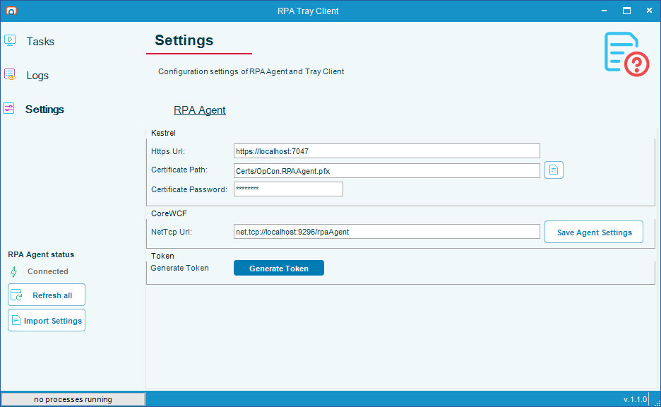
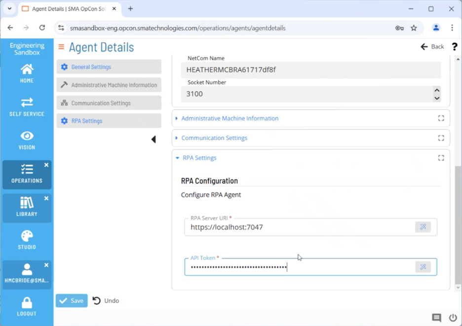

# Installation - OpCon RPA

## What is it?

This page walks you through installing OpCon RPA on a Windows system and connecting it to OpCon. The procedure has five steps:

1. Add an RPA agent in Solution Manager.
2. Install Netcom Relay (cloud installations only).
3. Copy the ACS Plugin DLL into the OpCon plugins directory.
4. Run the RPA Agent installer and choose an Agent mode.
5. Connect the RPA Agent to OpCon.

One further step is optional and can be done at any time afterwards on a Full mode Agent: [set up RDP login](#step-6--optional-set-up-rdp-login), so Robot Tasks that need the desktop run with nobody signed in on the host.

During the procedure, you will switch between two interfaces:

- The OpCon **Solution Manager** web interface.
- The **RPA Tray Client** on the Windows machine where you install the RPA Agent.

:::note No OpCon user required
Starting in 1.1.0, OpCon RPA stores tasks locally on the RPA Agent and no longer requires a dedicated OpCon user or an OpCon API connection. You do not need to create an RPA user in Solution Manager.
:::

## Before you begin

Have these three files ready:

| File | Where to get it | What it is for |
|------|-----------------|----------------|
| `SMANetcomRelay.exe` | Provided by your OpCon representative | Cloud installations only — installs Netcom Relay |
| `sma.acs.OpConRPA.dll` | [OpCon Web Installer (OWI)](https://github.com/smatechnologies/opcon-web-installer/releases) — **Integrations** section | The ACS plugin that lets OpCon communicate with the RPA Agent |
| `RPAAgent_x.y.z.msi` | [OpCon Web Installer (OWI)](https://github.com/smatechnologies/opcon-web-installer/releases) — **Agents** section | The RPA Agent installer (`x.y.z` is the version number) |

You also need:

- A Solution Manager user account with privileges to add an RPA agent.
- Local administrator rights on the Windows system where the RPA Agent will run. These are needed to run the installer and to apply the [Security Settings](./rpa-security-settings.md) — not for day-to-day operation.

:::note On-premises vs. cloud
Netcom Relay is required only when integrating RPA with a cloud instance of OpCon CORE Automate / Solution Manager. On-premises installations skip Step 2.
:::

:::note Decide on an Agent mode first
Starting in 1.3.0, the installer asks for an Agent mode on a first install: **Full**, the default, or **Background only**. You can change the mode later only by uninstalling and installing again, so decide before you start. See [Background only Agent mode](./rpa-background-only-mode.md#choose-an-agent-mode).
:::

## Step 1 — Add an RPA agent in Solution Manager

To define the RPA agent that OpCon routes jobs to, complete the following steps:

1. In Solution Manager, go to **Library** > **Agents**.
2. Select **Add** to add a new Agent.
3. Give the agent a name.
4. Select **RPA** from the **Type** list above **General Settings**.
5. When prompted, enter the Netcom Relay name. You must do this before you can open the **RPA Settings** page:
   - **Cloud:** enter the name you used during Relay installation.
   - **On-premises (no Relay):** type `<Default>`.

   

6. Open the **RPA Settings** section at the bottom of the page. Leave this page open — you will return to it in Step 5.

## Step 2 — Install Netcom Relay (cloud only)

If you are installing OpCon RPA for cloud, install Netcom Relay before continuing. For full instructions, see [Netcom Relay setup](https://help.smatechnologies.com/opcon-relay#install).

:::tip
Netcom Relay installation requires local administrator rights. When prompted to allow the app to make changes to your device, select **Yes**.
:::

After Relay is installed, return to this page and continue with Step 3.

## Step 3 — Copy the ACS Plugin DLL

To copy the ACS Plugin DLL into the OpCon plugins directory, complete the following steps:

1. In Windows File Explorer, open the OpCon plugins directory:
   - **On-premises:** `C:\ProgramData\OpConxps\SAM\plugins`
   - **Cloud:** open `C:\ProgramData\OpConxps\` and drill down to the `Plugins` directory.
2. Copy `sma.acs.OpConRPA.dll` into the plugins directory.

## Step 4 — Install the RPA Agent

Starting in 1.3.0, the installer is a short wizard, and on a first install it asks for an **Agent mode**. Upgrades keep the installed mode.

### 4a. Run the installer

To install the RPA Agent, complete the following steps:

1. Run `RPAAgent_x.y.z.msi` (the version number may differ). The **Welcome** step is displayed.
2. Select **Next**. The **Agent Mode** step is displayed.

    

3. Select the Agent mode:

    | Option | Result |
    |---|---|
    | **Full (LocalSystem): foreground and background tasks** | The service runs as Local System. The installer registers a credential provider and starts the Tray Client at every sign-in |
    | **Background only (NT SERVICE\RPA.Agent): background tasks only** | The service runs as `NT SERVICE\RPA.Agent` and runs every task as that account. No credential provider is installed, and the Tray Client does not start automatically |

4. Select **Next**. The **Ready to install** step is displayed.
5. Select **Install**.
6. When prompted to allow this app to make changes to your device, select **Yes**.
7. When the installation finishes, select **Finish**.

The installer registers the **RPA Agent** Windows service with the account for the mode you chose, and starts it. In Full mode the RPA Tray Client then opens automatically, under the account you are signed in as. In Background only mode it does not: open **RPA Agent Tray Client** from the **RPA Agent** folder of the Start menu before you continue with Step 5.

On an upgrade the **Agent Mode** step is not shown, because the installed mode is kept. Running the installer for the version that is already installed offers **Repair** and **Remove**.

:::note Full mode registers a credential provider
In Full mode, `InteractiveLogonCPx64.dll` is installed to `C:\Windows\System32` and registered so the Windows sign-in interface loads it. That is how the Agent unlocks a session with no one at the machine. Include it in the scope of any security review of the machine. A Background only install does not install it. See [What the installer changes on the machine](./rpa-permissions.md#what-the-installer-changes-on-the-host).
:::

### 4b. Install without the interface

A silent install with no properties installs a Full mode Agent:

```
msiexec /i RPAAgent_x.y.z.msi /qn
```

To install a Background only Agent, pass `AGENTMODE=BackgroundOnly`:

```
msiexec /i RPAAgent_x.y.z.msi AGENTMODE=BackgroundOnly /qn /l*v install.log
```

- `AGENTMODE` takes `Full` (the default) or `BackgroundOnly`, in any capitalization
- Any other value stops the installation with `AGENTMODE '<value>' is not valid. Use Full (the default) or BackgroundOnly.`
- On an upgrade, leave `AGENTMODE` out. The installed mode is kept, and an upgrade given a different mode is refused. See [Switch modes](./rpa-background-only-mode.md#switch-modes)
- An installation with the interface that is given `AGENTMODE` opens the **Agent Mode** step with that option already selected

:::note Verify the service after installing
Run `sc qc RPA.Agent` in an elevated command prompt and check `SERVICE_START_NAME`. It reads `LocalSystem` for a Full mode Agent and `NT SERVICE\RPA.Agent` for a Background only Agent. The Agent also records its mode, its service account, and the privileges present in its token in its log every time it starts successfully.
:::

## Step 5 — Connect the RPA Agent to OpCon

In this step, you switch between the RPA Tray Client (on the Windows host) and Solution Manager (in your browser, on the page you left open in Step 1). On a Background only Agent, open the Tray Client from the Start menu first.

### 5a. Copy the RPA HTTPS URI into Solution Manager

1. In the RPA Tray Client, select **Settings** in the left menu.

   

2. On the **RPA Agent** tab, copy the value from the **Https Url** field, under **Kestrel**.

   

3. In Solution Manager, paste the URI into the **RPA Server URI** field of the **RPA Settings** section you opened in Step 1.

   

### 5b. Generate and apply the API token

1. Back in the RPA Tray Client, select **Generate Token**, then select **Yes** in the warning that a new token replaces the existing one. The token is shown once and automatically copied to your clipboard.

   

2. In Solution Manager, paste the token into the **API Token** field.

   

3. Save your Solution Manager changes.

After you save, OpCon can communicate with the RPA Agent. Setup is complete.

## Verify the installation

After the success message:

- On a Full mode Agent, confirm the RPA Tray Client is running in the Windows system tray. On a Background only Agent, the Tray Client runs only while you have it open
- In Solution Manager, confirm the RPA agent shows as available under **Library** > **Agents**

## Step 6 — (Optional) Set up RDP login

Setup is complete without this step, and a Background only Agent does not use it. Do it when you want Robot Tasks that run in the foreground to run on the host with nobody signed in — OpCon then signs the Windows account in over a Remote Desktop connection before each run, and the task signs it out afterwards. A Robot Task that runs in the background needs no session and no RDP login. See [Background and foreground execution](./robot-task-rpa.md#background-and-foreground-execution).

Set this up when nobody signs in on the host to create the sessions foreground Robot Tasks run in. The Agent can unlock a session that already exists, but it cannot create one — so without an RDP login user, somebody has to be signed in. On a Windows workstation edition an RDP login user is also how you automate more than one account, because those editions support only one interactive session at a time.

You configure it in two places, both after installation:

| Where | What you add |
|---|---|
| The RPA agent's **RPA Settings** section in Solution Manager | The RPA host's address in **Target Host (IP or hostname, optional — required only for RDP logins)** and its **RDP Port**, plus optional display size, color depth, and timeout fields |
| The **Windows Login Credentials** section below it | One entry per Windows account a Robot Task runs as, each with a domain, username, and password |

Then set **RDP Login User (optional)** on each Robot Task to the account it should sign in as.

For the full procedure with screenshots, see [Configure RDP login](./rpa-rdp-login.md#configure-rdp-login). For how it fits with ending the session afterwards, see [Unattended Session](./rpa-unattended-session.md).

## FAQs

**Do I need Netcom Relay if I am not using OpCon Cloud?**
No. Netcom Relay is required only for cloud integrations with OpCon CORE Automate / Solution Manager. On-premises installations skip Step 2.

**Where do I place the ACS Plugin DLL on an on-premises installation?**
For on-premises installations, place `sma.acs.OpConRPA.dll` in `C:\ProgramData\OpConxps\SAM\plugins`.

**Do I need to create an OpCon user for RPA?**
No. Starting in 1.1.0, OpCon RPA stores tasks locally on the RPA Agent and no longer requires an OpCon user or an OpCon API connection.

**What do I enter for the Netcom Relay name on an on-premises installation?**
Type `<Default>`. Solution Manager requires a value before it lets you open the RPA Settings page.

**What account does the RPA Agent service run under?**
It depends on the Agent mode you choose at install. A Full mode Agent runs as Local System, because it has to unlock and switch desktop sessions, which Windows restricts to Local System. A Background only Agent runs as `NT SERVICE\RPA.Agent`. See [Service Accounts and Permissions](./rpa-permissions.md#account-summary).

**Do I have to grant the service account any rights myself?**
In Full mode, no. Local System already holds every local privilege, so the installer changes no Windows rights and no folder permissions. In Background only mode, the installer grants the service account the folders the Agent itself needs. You grant it, or the computer account, the files, shares, and sites your tasks use. See [Background only Agent mode](./rpa-background-only-mode.md#network-access).

**Is there anything to configure for a silent install?**
Only the Agent mode. `msiexec /i RPAAgent_x.y.z.msi /qn` installs a Full mode Agent. Add `AGENTMODE=BackgroundOnly` for a Background only Agent. See [Install without the interface](#4b-install-without-the-interface).

**Can I change the Agent mode after installing?**
Not with an upgrade, which always keeps the installed mode. Uninstall the RPA Agent and install it again with the other mode. Your tasks and credentials stay on the machine. See [Switch modes](./rpa-background-only-mode.md#switch-modes).

**Do the users that run robot tasks need local administrator rights?**
No. Local administrator rights are required only to run the installer and apply the Windows local security policies. See [Service Accounts and Permissions](./rpa-permissions.md).

## Related topics

- [Background only Agent mode](./rpa-background-only-mode.md)
- [Service Accounts and Permissions](./rpa-permissions.md)
- [Unattended Session](./rpa-unattended-session.md)
- [Security Settings](./rpa-security-settings.md)
- [Update - OpCon RPA Agent and ACS plugin](./update-opcon-rpa.md)

## Glossary

| Term | Definition |
|------|-----------|
| ACS Plugin DLL | The OpCon Application Connection Studio plugin file (`sma.acs.OpConRPA.dll`) used by the OpCon SAM to communicate with the RPA Agent. |
| RPA Agent | The agent that performs robot task automation on a target Windows machine. |
| RPA Tray Client | The local Windows interface that runs alongside the RPA Agent, used to configure the HTTPS URI and API token. |
| Netcom Relay | The OpCon component that routes communication between the OpCon Server and the RPA Agent for cloud installations. |
| OpCon Web Installer (OWI) | A tool that bundles OpCon installer artifacts, including the ACS Plugin DLL and the RPA Agent Installer. |
| Solution Manager | The OpCon web interface used to configure agents and schedules. |
| Agent mode | The install-time choice of how the RPA Agent service runs: **Full** or **Background only**. Upgrades keep it. |
| Local System | The built-in Windows account (`NT AUTHORITY\SYSTEM`) that holds every privilege on the local machine. A Full mode RPA Agent service runs as Local System so it can prepare desktop sessions. It has no password. |
| `NT SERVICE\RPA.Agent` | The Windows virtual account a Background only RPA Agent service runs as. It has no password and no administrator rights. |
