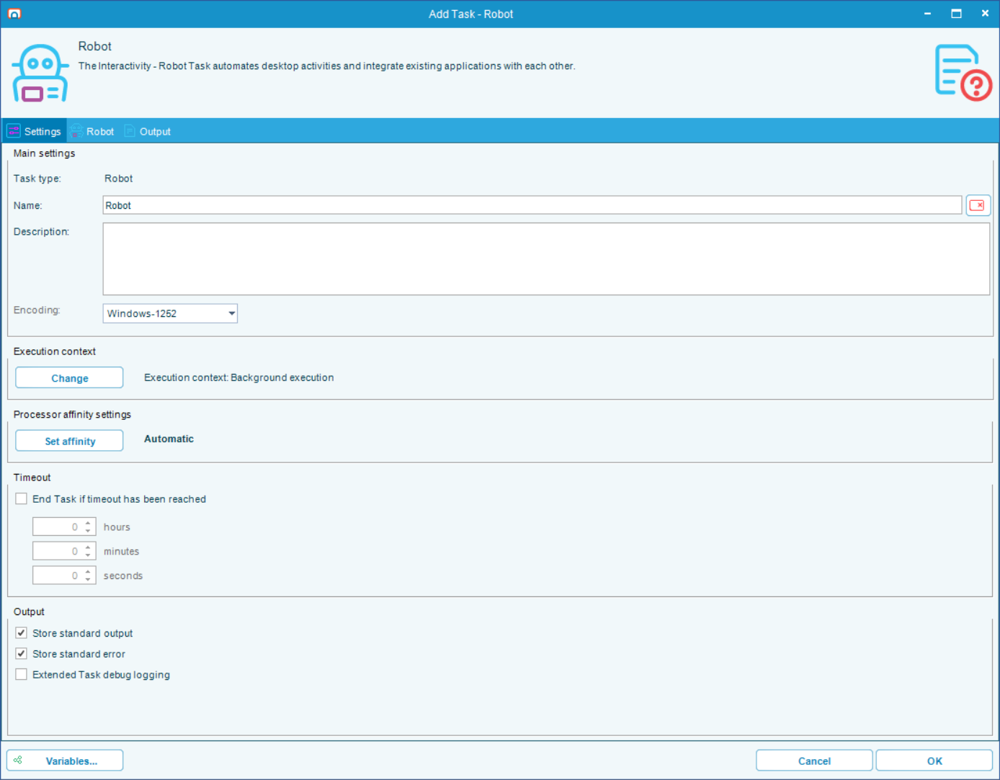
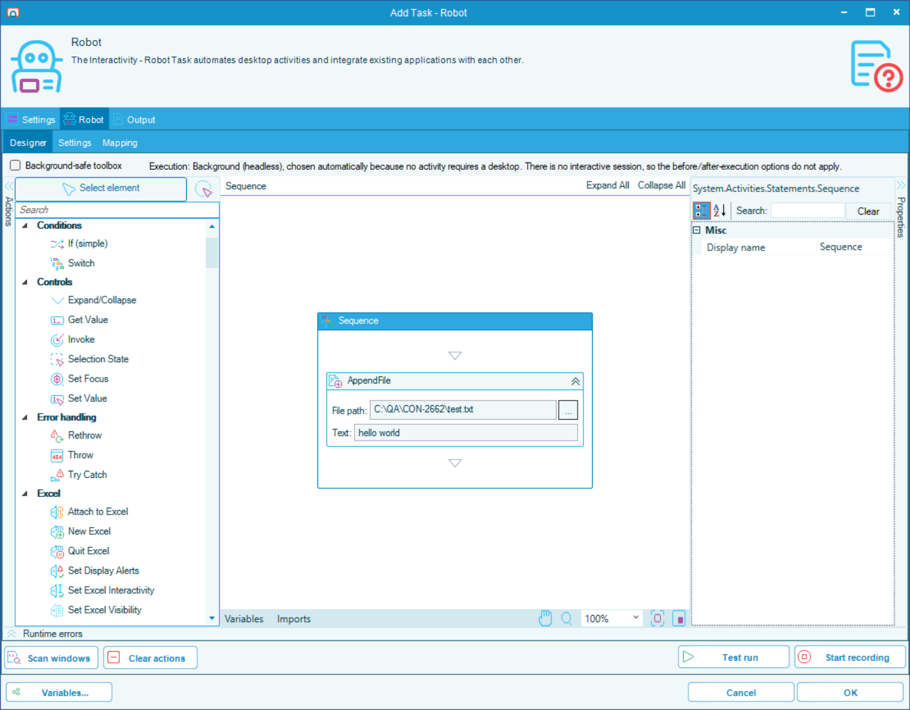
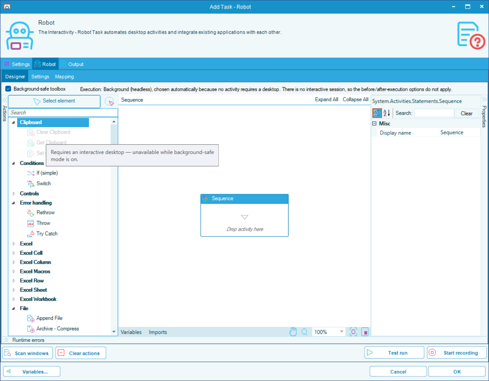
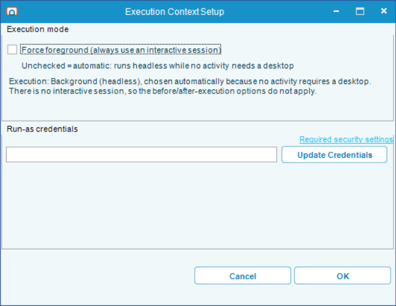
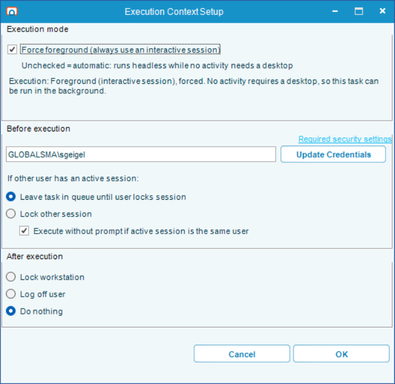
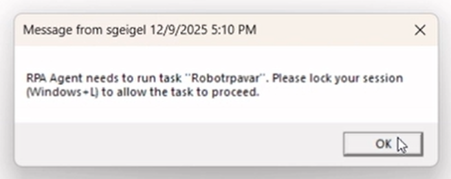
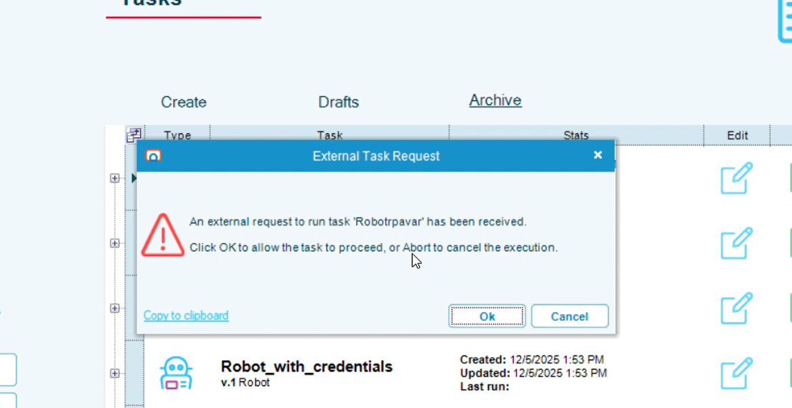
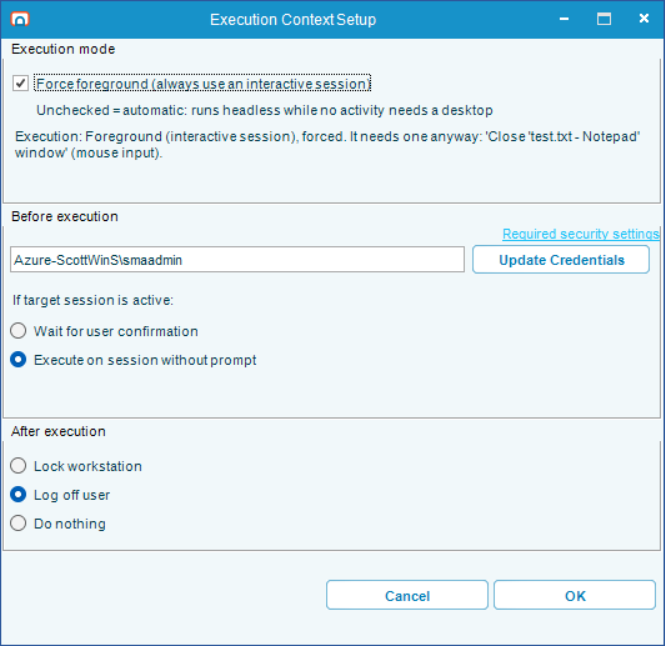
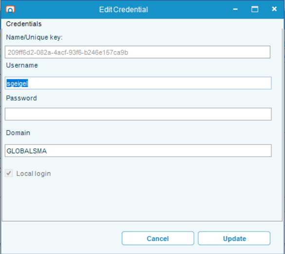

# Robot Tasks

## What is it?

A Robot Task interacts with Microsoft Windows on behalf of a user. Robot Tasks can be created by:

- Recording actions a user performs on the desktop, or
- Dragging and dropping individual activities into the workflow, or
- Combining both.

Three concepts work together to make a Robot Task run safely and predictably:

| Concept | What it controls |
|---------|------------------|
| **Robot Task** | What the task does — the recorded or dragged activities. |
| **Execution Context** | How the task interacts with the machine — the user identity, whether the task may run in the background, what happens before the task runs, and what happens after. |
| **Credentials** | The encrypted Windows credentials RPA uses to run the task as the correct user. |

A Robot Task runs in one of two ways. A task whose activities all work without a desktop runs in the **background**, with nobody signed in. Any other task runs in the **foreground**, in the user's own Windows session. See [Background and foreground execution](#background-and-foreground-execution).

This page explains all of these.

## Quick reference — pick a behavior

| What you want | On a single user machine | On a multi-user machine |
|---------------|--------------------------|-------------------------|
| Run with no Windows session at all | Use only background-safe activities and leave **Force foreground** cleared. See [Background and foreground execution](#background-and-foreground-execution) | Same as on a single user machine |
| Keep a task in the interactive session even though it could run in the background | Select **Force foreground** | Select **Force foreground** |
| Run automatically with no popups | Select **Lock other session** | Select **Execute on session without prompt** |
| Approve each task before it runs | Select **Leave task in queue until user locks session** | Select **Wait for user confirmation** |
| Leave the session unlocked after the task | Select **Do nothing** under After Execution Behaviors | Select **Do nothing** under After Execution Behaviors |
| End the session after the task | Select **Log off user** under After Execution Behaviors | Select **Log off user** under After Execution Behaviors |
| Run a task that needs the desktop with nobody signed in on the host | Give the task an RDP login user and select **Log off user** | Give the task an RDP login user and select **Log off user** |

The Before and After Execution Behaviors in this table apply only to a task that runs in the foreground.

### Machine type quick check

| Machine type | Examples | Key difference |
|--------------|----------|----------------|
| **Single user** | Windows workstation editions | Only one user can control the desktop at a time. |
| **Multi-user** | Windows Server editions | Multiple users can have active desktop sessions simultaneously. |

The machine type matters only for a foreground run. A background run uses no desktop session, so it behaves the same on both.

## Execution Context

The Execution Context is set on the main form with the **Change** button under **Execution context**, which opens the **Execution Context Setup** window. It sets the account the task runs as and whether the task may run in the background. For a task that runs in the foreground, it also controls how the task interacts with the machine before and after the task runs. By default, the Execution Context is set to the user that is currently logged in and editing the task.

:::note Privilege level of the Execution Context user
The task runs as the Execution Context user, so it acts with exactly the privileges of that account. That account does not need local administrator rights — grant it only the rights the applications the task drives require. The RPA Agent service's own privileges do not extend what a task can do. See [Service Accounts and Permissions](./rpa-permissions.md).
:::

:::tip Required at Publish, optional for Drafts
An Execution Context is required to **Publish** a Robot Task, whether it runs in the background or the foreground. **Drafts** can be saved without one. When another user edits this task, your Execution Context settings remain unchanged unless that user opens the Execution Context menu. On a Background only Agent, a task needs no Execution Context. See [On a Background only Agent](#on-a-background-only-agent).
:::

:::warning A foreground task needs a Windows session, and the RPA Agent cannot sign a user in
A task that runs in the foreground runs inside the Execution Context user's Windows session. The RPA Agent **cannot sign a user in**. It can only run a foreground task for an account that already has a Windows session on the host, so give each foreground Robot Task an **RDP login user**: OpCon then signs the account in for the run. Nothing has to be done after a reboot, and nobody has to be signed in at the machine. To set this up, see [Configure RDP login](./rpa-rdp-login.md#configure-rdp-login).

The Agent can unlock a session belonging to a user who is already signed in, but it cannot create one. A foreground task with no RDP login user therefore depends on someone having signed in first, which after a reboot means signing in as each user manually:

1. After the reboot, sign in as `UserA`.
2. Press Win+L to lock the session.
3. Sign in as `UserB`.
4. Press Win+L to lock the session.
5. RPA can now run tasks for both users.

Locking each session at the end is part of the procedure because the Agent unlocks it again for the task. Leaving the sessions unlocked works too, but it leaves an open desktop per account.

A task that runs in the background needs none of this. See [Background and foreground execution](#background-and-foreground-execution).
:::

## Background and foreground execution

A Robot Task runs either in the background or in the foreground. The mode is resolved from the task's activities and one setting, **Force foreground**.

| | Background | Foreground |
|---|---|---|
| Where the task runs | In a host process the RPA Agent starts for the run, as the task's run-as user | In the run-as user's own Windows session, through the Tray Client in that session |
| Needs somebody signed in | No. No Windows session is used, and none is created | Yes. A session OpCon creates over Remote Desktop, or one a person signed in to |
| Before and After Execution Behaviors | Do not apply | Apply |
| Which tasks | Tasks whose activities are all background-safe, with **Force foreground** cleared | Every other task, including every task saved before 1.3.0 |

Background execution for Robot Tasks is new in 1.3.0. Earlier versions ran every Robot Task in the foreground.

### How the mode is chosen

A Robot Task runs in the background only when all of the following are true:

- **Force foreground** is cleared in the task's Execution Context
- Every activity in the workflow is background-safe. See [Which activities are background-safe](#which-activities-are-background-safe)
- The task plays back in Step mode. Map mode drives application windows, so a task set to Map mode under **Execution mode:** in its **Playback settings** always runs in the foreground

Otherwise the task runs in the foreground, as every Robot Task did before 1.3.0.

The editor shows the resolved mode while you build the task. The RPA Agent makes the same check again from the published task each time it starts a run, and keeps the task in the foreground if it cannot read the workflow.

On a Full mode Agent, every Robot Task needs a run-as user, in either mode. A background run uses that account to start the task's host process; a foreground run uses it to find and prepare the user's session.

### Which activities are background-safe

An activity is background-safe when it does not need an interactive desktop. In the toolbox:

| Toolbox section | Background-safe |
|---|---|
| **Conditions**, **Error handling**, **Loops** | Every activity |
| **Other** (**Assign**, **Sequence**, **Wait**) | Every activity |
| **Variables** | Every activity |
| **Processes** (**Start Process**, **Close Process**) | Every activity |
| **File** | Every activity except **Open File** |
| **Folder** | Every activity except **Open Folder** |
| **List Variable** | Every activity. **List - Save** is background-safe when it saves to a file; saving to the clipboard needs the desktop |

Every other section needs the desktop: **Windows**, **Controls**, **Mouse**, **Keyboard**, **Text**, **Clipboard**, **Image**, **OCR**, **User input**, every **Excel** section, **Outlook**, **Web Macro** (including **Open Browser**), **Web Browser**, and **Community**. One such activity anywhere in the workflow, including inside a loop, a condition, or a Try Catch, keeps the whole task in the foreground.

A program that **Start Process** starts during a background run has no visible desktop. Use it for programs that run without user interaction.

### Check the execution mode while you build

The editor shows the mode a task resolves to in two places.

- **Settings** tab: the label next to the **Change** button under **Execution context** reads **Execution context: Background execution** or **Execution context: Foreground execution**
- **Robot** tab: a strip above the workflow designer describes the mode and why, and updates as you add, remove, or change activities

The indicator reads one of the following.

| Indicator text | What it means |
|---|---|
| **Execution: Background (headless), chosen automatically because no activity requires a desktop.** | The task runs in the background. The Before and After Execution Behaviors do not apply |
| **Execution: Foreground (interactive session). Automatic mode found an activity that requires an interactive desktop: '...'** | The named activity, or a task setting such as Map mode, keeps the task in the foreground. Remove or replace it to let the task run in the background |
| **Execution: Foreground (interactive session), forced. No activity requires a desktop, so this task can be run in the background.** | **Force foreground** is selected, but nothing in the task needs it. Clear it to let the task run in the background |
| **Execution: Foreground (interactive session), forced. It needs one anyway: '...'** | **Force foreground** is selected, and the named activity would keep the task in the foreground regardless |

When the task resolves to the background but still stores an After Execution Behavior of **Lock workstation** or **Log off user**, the indicator adds a warning in red: the behavior is skipped while the task runs in the background, and runs again if the task returns to the foreground. This happens when the behavior was set while the task needed the desktop and the activity that needed it was then removed. The stored setting is kept, not cleared.

A new Robot Task starts out reading **Background execution**, because an empty workflow needs no desktop. It changes as soon as you add an activity that needs one.

### Build a task from background-safe activities only

Select the **Background-safe toolbox** option on the strip above the workflow designer to gray out every activity that needs a desktop. Sections in which every activity needs a desktop, such as **Clipboard** or **Excel**, collapse while the option is on; expand one to see its grayed activities. Hovering over a grayed activity shows **Requires an interactive desktop — unavailable while background-safe mode is on.**

The option is a filter on the toolbox only. It does not remove activities that are already in the workflow, it does not stop an activity arriving by paste, it does not change how the task runs, and it is not saved with the task. The indicator remains the authority on which mode the task resolves to.

### Force foreground

**Force foreground (always use an interactive session)** is an option in the **Execution mode** group at the top of the **Execution Context Setup** window. It appears only for Robot Tasks.

- **Cleared** — automatic. The window states **Unchecked = automatic: runs headless while no activity needs a desktop**. The task runs in the background while every activity is background-safe, and in the foreground as soon as one is not
- **Selected** — the task always runs in the foreground, whatever its activities

When the task resolves to the background, the window shows only the **Run-as credentials** group: the account to run as, with the **Enter Credentials** or **Update Credentials** button. The Before and After Execution options are hidden, because there is no session to lock, unlock, or sign out. Selecting **Force foreground** brings them back, with their stored values unchanged, and the group is captioned **Before execution** again.

There is no option to force a task into the background. A task with an activity that needs a desktop always runs in the foreground.

#### When to select Force foreground

The editor can judge a task only by its own activities. Select **Force foreground** when the task depends on something it cannot see:

- **The task shares a session with other tasks in the same job.** For example, one task signs in or opens an application, later tasks work in it, and a last task closes it. Each task can be background-safe on its own while the job depends on all of them running in the same session
- **A later task uses a program this task starts.** A program started in a background run has no visible desktop, and a later foreground task cannot reach it
- **The task uses custom or third-party activities**, for example from the **Community** section of the toolbox. Keep such a task in the interactive session
- **The task must keep its After Execution Behavior**, for example **Log off user** at the end of each run

### Tasks saved before 1.3.0

Every Robot Task saved before 1.3.0 counts as having **Force foreground** selected. After the update, it keeps running in the foreground exactly as before, whatever its activities. Nothing migrates to the background on its own.

Opening and saving such a task does not change this either: the **Execution Context Setup** window shows **Force foreground** selected, and it stays selected until you clear it. Only a Robot Task created in 1.3.0 or later starts with **Force foreground** cleared.

The exception is an Agent installed in Background only mode, where saving a task clears **Force foreground**. See [Background only Agent mode](./rpa-background-only-mode.md).

### Let an existing task run in the background

Before you start, confirm the task does not depend on the session of another task in its job. See [When to select Force foreground](#when-to-select-force-foreground).

To let an existing Robot Task run in the background, complete the following steps:

1. Open the task in the editor.
2. Select the **Robot** tab and read the indicator above the workflow designer. If it reads **No activity requires a desktop, so this task can be run in the background**, continue. If it names an activity, the task needs the desktop and keeps running in the foreground.
3. Select the **Settings** tab.
4. Select the **Change** button under **Execution context**.
5. In the **Execution Context Setup** window, clear the **Force foreground (always use an interactive session)** option.
6. Select the **OK** button.
7. Save and publish the task.

The label under **Execution context** reads **Execution context: Background execution**, and the next run of the task runs in the background.

:::note Publishing creates a new version
Saving a published task stores it as a new version. An OpCon job set to use the latest version runs the new version from its next run, but a job set to a specific version keeps running the earlier, foreground version until the job's version is changed.
:::

### What is different about a background run

- **No session is used.** The RPA Agent starts a host process for the run as the run-as user, with that user's profile loaded and the profile folder as the working folder. The task does not run in a session the user already has open, even if one exists, and no Tray Client is involved
- **No RDP login user is needed.** See [Background Robot Tasks need no session](./rpa-unattended-session.md#background-robot-tasks-need-no-session)
- **The run-as user needs a logon right.** The account must hold **Log on as a batch job** or **Allow log on locally** on the host. See [A background task ends Aborted because its run-as user cannot log on](./troubleshooting-opcon-rpa.md#a-background-task-ends-aborted-because-its-run-as-user-cannot-log-on)
- **A runtime limit applies.** Background runs are stopped after 60 minutes by default. See [Background tasks have a runtime limit](./troubleshooting-opcon-rpa.md#background-tasks-have-a-runtime-limit)
- **The log is in a different place.** The host process logs under `HeadlessRunner\<execution user>`. See [Where the logs are](./troubleshooting-opcon-rpa.md#where-the-logs-are)

### Turn off background execution for Robot Tasks on an Agent

The `RouteBackgroundRobotTasks` setting in `C:\Program Files\RPAAgent\appsettings.json` ships set to `true`. Set it to `false` to run every Robot Task on that Agent in the foreground, whatever each task's **Force foreground** setting says. Web Macro and Scan Document tasks are not affected.

The Agent reads the setting each time it starts a task, so the change applies from the next run. The editor's indicator does not reflect this setting: it shows the mode the task resolves to on an Agent that allows background execution. An Agent installed in Background only mode ignores the setting.

### On a Background only Agent

An Agent installed in Background only mode runs only tasks that resolve to the background, as its own service account. There, **Force foreground** is cleared and unavailable, and a Robot Task that needs the desktop is refused. See [Background only Agent mode](./rpa-background-only-mode.md).

## Before Execution Behaviors

The Before Execution Behavior controls what happens **between** the moment RPA receives a command to run the task and the moment the task starts.

Before Execution Behaviors apply only to a task that runs in the foreground. For a task that resolves to the background, the **Execution Context Setup** window hides them. See [Force foreground](#force-foreground).

The available options depend on the machine type.

### Single user machines

For single user machines (Windows workstation editions), only one user can control the machine at a time, so RPA may need to switch sessions before running. The options are shown under **If other user has an active session:**.

To assign your user to the task, select the **Enter Credentials** button — it reads **Update Credentials** once a credential for that user exists.

| Option | What RPA does | Use when |
|--------|---------------|----------|
| **Leave task in queue until user locks session** | Sends a message to the currently logged-in user asking them to lock the session. Selecting **OK** only dismisses the message: the task waits until the session is actually locked (Win+L), for up to five minutes, after which it proceeds anyway. | Testing, or when combined with **Execute without prompt if active session is the same user**. |
| **Execute without prompt if active session is the same user** *(modifier — only available with the option above)* | Skips the confirmation window when the Execution Context user matches the currently logged-in user, and runs the task immediately. | Same-user automation that should not interrupt the user. |
| **Lock other session** | Locks the active session if it belongs to a different user than the Execution Context user, then runs the task. If the active session already belongs to the Execution Context user, runs the task directly. | Hands-off, scheduled automation. |

The windows look like this:

*Different user logged in: the user can dismiss the message, but the task waits until the session is locked.*

*Same user logged in: the **External Task Request** window. Selecting **Yes** starts the task; selecting **No** cancels it, and the run is reported as a task failure.*

### Multi-user machines

For multi-user machines (Windows Server editions), multiple users can have active desktop sessions at the same time. Session switching is not needed, but locking sessions is still important for security. The options are shown under **If target session is active:**.

To assign your user to the task, select the **Enter Credentials** button — it reads **Update Credentials** once a credential for that user exists.

The target session is unlocked before the task runs, if it was locked. The task runs only in a session that belongs to its Execution Context user. If another user is signed in and the Execution Context user is not, the task does not start.

| Option | What RPA does | Use when |
|--------|---------------|----------|
| **Wait for user confirmation** | Shows the **External Task Request** window in the target session. The task waits until the user selects **Yes**. | Testing, or when a human gate is required. |
| **Execute on session without prompt** | Runs the task on the user's session immediately, with no warnings or prompts. | Hands-off, scheduled automation. |

**Wait for user confirmation** shows the same **External Task Request** window as the single-user same-user case, in the target session:

:::note RDP sessions
When RPA locks a session, it does not end RDP connections. If the user was logged in through RDP, the connection remains active, but the session shows a lock screen.
:::

## After Execution Behaviors

After Execution Behaviors apply to both single user and multi-user machines, and only to a task that runs in the foreground. A task that runs in the background has no session to lock or sign out, so its After Execution Behavior is skipped.

| Option | What RPA does | Use when |
|--------|---------------|----------|
| **Lock workstation** | Locks the current user (equivalent of Win+L) after the task completes. | The session must stay available for the next run, behind a lock screen. |
| **Log off user** | Signs the Execution Context user out of Windows after the task completes. The session ends and open applications close. | The session must not remain available between runs — for example, to release the resources it holds or to satisfy a policy that limits standing sessions. Pair it with an RDP login user for unattended work. |
| **Do nothing** | Leaves the running user's session unlocked. | Chaining multiple RPA tasks under the same user, to avoid delays from repeated lock/unlock cycles. |

:::note How the sign-out is carried out
**Log off user** needs no configuration, and you do not choose which route it takes. The Agent ends the session itself, and falls back to asking the Tray Client in that session to sign itself out if it cannot — which also covers a session whose Tray Client has stopped responding. Either way it targets exactly the session that ran the task, not another session belonging to the same user. When the Tray Client does the signing out it acknowledges first and waits about five seconds, so its reply reaches the Agent before the session ends.
:::

:::warning Log off user needs an RDP login user for recurring tasks
The RPA Agent cannot sign a user in. Once a session is signed out, the Agent on its own cannot run another foreground task for that user until a person signs in as that user again.

If the task has an RDP login user, this is handled for you: the next run finds no session and signs the account back in. Pairing **Log off user** with an RDP login user leaves no standing session between runs, which is the recommended setup — see [Unattended Session](./rpa-unattended-session.md).

Without an RDP login user, choose **Lock workstation** instead when the same user runs tasks on a schedule — the Agent unlocks the session again for the next run.
:::

:::caution Signing out closes applications without saving
**Log off user** ends the session, so any unsaved work in that session is lost. Use it only when nothing in the session needs to persist between runs.

RPA signs a user out only when it positively identifies the exact session that ran the task. If it cannot, it takes no action and records a warning rather than risk signing out a different user. This differs from **Lock workstation**, which on a machine with exactly one active session falls back to that session. **Log off user** never falls back, because signing out the wrong user is destructive.

A sign-out gives running applications the chance to save work, so an application holding an unsaved document can cancel it. When that happens the session keeps running, and about 45 seconds later the Agent's log records that the sign-out was cancelled.
:::

## Finding windows and elements at runtime

An activity locates the window and the control it acts on by name. A recording captures those names exactly as they appeared, which makes a task fragile when a caption carries a value that changes between runs — a record number, a customer name, or a timestamp.

Window titles and element text are matched as patterns, so you can replace the part that varies with a wildcard. A window titled `Acme Teller — Session 4102` is matched reliably by `Acme Teller*`. The same wildcards apply to the file and folder filters used by file-handling activities.

For the characters you can use and how matching decides whether a value fits, see [Wildcard Matching](./rpa-wildcard-matching.md).

## Credentials

The edit credentials window shows information from your current Windows session. **Name/Unique key**, **Username**, and **Domain** are filled in from your session and cannot be edited, and **Local login** is always selected. The only field you complete is **Password**.

### How your credentials are protected

Your credentials are secured through several layers:

1. **Secure transmission:** Credentials are sent to the RPA Agent service on the local machine over an encrypted channel that authenticates you with your Windows session. They never leave the host.
2. **Encryption:** Your username and password are encrypted with a randomly generated key created the first time you started RPA. The key itself is protected by Windows so that it can only be used on that machine.
3. **GUID reference:** Internally, RPA references you only by a GUID (unique identifier). Robot tasks and Execution Contexts hold the GUID, not your password.
4. **One-time entry:** After initial setup, you do not need to enter your password again when creating additional Execution Contexts.

### First-time setup

If this is the first time setting up your user for RPA, complete the following steps:

1. Enter your Windows password.
2. Confirm the window.
3. RPA verifies the password is correct for this user account.

### How credentials are used during execution

When the Agent service receives a command to run a task:

1. It looks up the GUID for the task.
2. It decrypts the stored credentials.
3. For a foreground run, it switches to the appropriate user session. For a background run, it starts the task's host process as that user.
4. It holds the decrypted credentials in memory only for the duration of the task.

Credentials are never stored in plain text and are never persisted in decrypted form.

## FAQs

**Will my existing Robot Tasks start running in the background after updating to 1.3.0?**
No. Every Robot Task saved before 1.3.0 counts as having **Force foreground** selected, so it keeps running in the foreground until you clear that option yourself. See [Tasks saved before 1.3.0](#tasks-saved-before-130).

**Does the Run button on the Tray Client's Tasks page test a background run?**
No. A task started from the **Tasks** page runs inside the Tray Client, as the account you are signed in as, on your desktop. To test how the task runs in the background, run it from OpCon.

**Why does my task wait when I select "Leave task in queue until user locks session"?**
RPA intentionally waits until the user locks the session (Win+L) before running the task, which lets the user finish what they are doing first. Selecting **OK** on the message only dismisses it; it does not lock the session. If the session is still not locked after five minutes, RPA stops waiting and switches to the task's user anyway.

**Why can't RPA run my task after a server reboot?**
If the task runs in the foreground, it needs a Windows session, and the RPA Agent cannot sign a user in, so it can only run the task for an account that already has a session. Give the task an **RDP login user** and OpCon signs the account in for each run, which removes the need for anything to happen after a reboot — see [Configure RDP login](./rpa-rdp-login.md#configure-rdp-login). Without one, somebody has to sign in as each user manually after the reboot and lock each session. A task that runs in the background is not affected by a reboot.

**Should I use Lock workstation or Log off user?**
**Log off user** leaves no signed-in desktop between runs, which is the better security position and what an [unattended session](./rpa-unattended-session.md) uses. **Lock workstation** keeps the session available behind a lock screen, which suits the same user running tasks on a schedule — the Agent unlocks it again for the next run.

**My task with Lock workstation ran but the session was not locked.**
First confirm the task ran in the foreground: a task that runs in the background skips its After Execution Behavior. Otherwise, RPA locks a session only when it positively identifies the session that ran the task. If it cannot — most often on a multi-user host — the task still succeeds and the lock is skipped, with a warning in the Agent's log naming the user. Check the log, and confirm the account has its own session on that host. See [Permissions Troubleshooting](./rpa-permissions-troubleshooting.md).

**Will my existing tasks keep working after updating to 1.2.0?**
Yes. Session unlocking and locking work as they did, and every existing setting is preserved. Moving a task to an [unattended session](./rpa-unattended-session.md) — an RDP login user plus **Log off user** — is recommended rather than required, because it leaves no signed-in desktop between runs.

**Are my Windows credentials stored in plain text?**
No. Credentials are encrypted with a randomly generated key created the first time you started RPA, and are referenced only by GUID. The Agent service decrypts them in memory when it needs them — when it prepares the session or the host process for a task, or when you open a stored credential in RPA — and never writes them to disk in decrypted form.

**Can I save a draft task without an Execution Context?**
Yes. An Execution Context is required only at the **Publish** stage. Drafts can be saved without one.

**Does locking a session end an RDP connection?**
No. Locking a session leaves the RDP connection active — the session shows a lock screen, but the connection remains.

**Can I chain multiple Robot Tasks under the same user without locking and unlocking each time?**
Yes. Set the After Execution Behavior to **Do nothing** for the intermediate tasks. The session stays unlocked, which avoids the delays caused by repeated lock/unlock cycles. If the tasks rely on that shared session, select **Force foreground** on each of them so none moves to the background.

**What is the difference between "Lock workstation" and "Log off user"?**
**Lock workstation** leaves the session running behind a lock screen, and RPA can unlock it for the next task. **Log off user** ends the session entirely and closes open applications. RPA cannot sign a user back in, so a person must sign in as that user before RPA can run foreground tasks for them again.

**My task finished but the user was not signed out. Why?**
A task that runs in the background skips its After Execution Behavior. For a foreground task, RPA signs a user out only when it positively identifies that user's own session. If it cannot find that session, it takes no action and records a warning instead of signing out a different user. This is most common on multi-user machines. Check the RPA Agent log for a warning naming the user.

**Does the Execution Context user need local administrator rights?**
No. The task runs at the privilege level of that account, so grant it only what the applications it drives require. See [Service Accounts and Permissions](./rpa-permissions.md).

## Related topics

- [Unattended Session](./rpa-unattended-session.md)
- [RDP Login](./rpa-rdp-login.md)
- [Background only Agent mode](./rpa-background-only-mode.md)
- [Task Types](./task-types-overview.md)
- [Wildcard Matching](./rpa-wildcard-matching.md)
- [Service Accounts and Permissions](./rpa-permissions.md)
- [Security Settings](./rpa-security-settings.md)
- [Troubleshooting](./troubleshooting-opcon-rpa.md)

## Glossary

| Term | Definition |
|------|-----------|
| Robot Task | An OpCon RPA task that interacts with Windows on behalf of a user. |
| Execution Context | The configured rules for how a Robot Task interacts with the machine, including the user identity, whether the task may run in the background, and what happens before and after a foreground run. |
| Background execution | A Robot Task run in a host process the RPA Agent starts as the run-as user, with no Windows session and nobody signed in. |
| Foreground execution | A Robot Task run inside the run-as user's own Windows session, through the Tray Client in that session. |
| Background-safe activity | An activity that does not need an interactive desktop, such as a file, folder, list, variable, or flow-control activity. |
| Force foreground | The Execution Context option that keeps a Robot Task in the foreground even when all its activities are background-safe. Every task saved before 1.3.0 counts as having it selected. |
| Before Execution Behavior | The action RPA takes between receiving a command to run a foreground task and starting the task — for example, lock another session or wait for confirmation. |
| After Execution Behavior | The action RPA takes after a foreground task completes — lock the workstation, sign the user out, or leave the session unlocked. |
| Single user machine | A Windows workstation edition, where only one user controls the desktop at a time. |
| Multi-user machine | A Windows Server edition, where multiple users can have active desktop sessions simultaneously. |
| Tray Client | The OpCon RPA client that runs in the Windows system tray. |
| RPAAgent service | The local service that the Tray Client communicates with over an authenticated, encrypted channel on localhost to manage tasks and credentials. |
| GUID | A unique identifier RPA uses internally to reference a credential record without exposing the username or password. |
