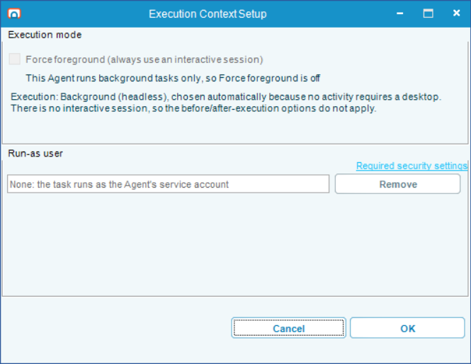
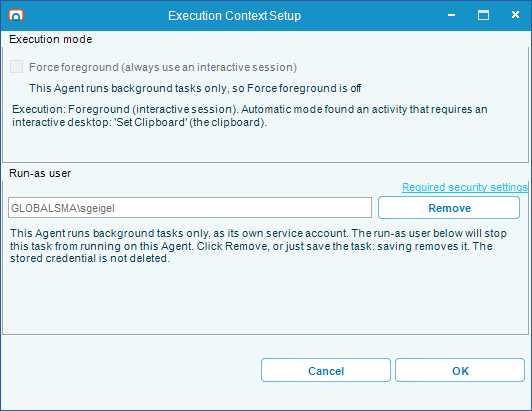
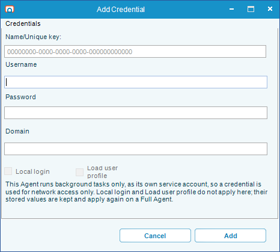

# Background only Agent mode

## What is it?

Starting in 1.3.0, you choose an **Agent mode** when you install the RPA Agent. **Full**, the default, is how every earlier version was installed: the service runs as Local System and runs every task type. **Background only** runs the service as the virtual account `NT SERVICE\RPA.Agent`, with no administrator rights, and runs every task in the background as that account.

This page helps you choose a mode, describes what a Background only Agent runs and how the task editor behaves on it, and explains how it reaches the files, shares, and sites its tasks use.

:::note Nothing changes unless you choose it
Background only is opt-in. An install that does not choose a mode is Full, and an upgrade keeps the mode already installed. Upgrading a 1.2.x Agent to 1.3.0 therefore keeps it in Full mode, which works exactly as it did before.
:::

## Choose an Agent mode {#choose-an-agent-mode}

The question that decides the mode is whether your tasks need a Windows desktop or a specific Windows user.

Choose **Full** when a task interacts with a desktop session, for example a Robot task that drives a Windows application or uses an activity that is not background-safe, or when tasks must run as particular Windows accounts.

Choose **Background only** when every task can run in the background, and running all of them under one service identity makes access to your data easier to secure, or you do not want a user account to run your automation.

The trade-off is that one account does all the work. In Full mode a task can run as a real Windows user, with that user's access. In Background only mode every task, whoever authored it, runs as `NT SERVICE\RPA.Agent`, so every task can reach whatever that account can reach, including the Agent's own files.

Both modes run tasks from a cold boot. A Background only Agent starts with Windows and needs nobody signed in. A Full Agent can sign a task's user in with RDP login when a foreground task needs a session. See [Unattended Session](./rpa-unattended-session.md).

The two modes differ in the following ways:

| | Full | Background only |
|---|---|---|
| Service account | Local System (`NT AUTHORITY\SYSTEM`) | `NT SERVICE\RPA.Agent`, a virtual account with no password |
| Windows privileges | Every local privilege | **Bypass traverse checking** (`SeChangeNotifyPrivilege`) only. No administrator rights, and the installer adds no user rights assignments |
| Task types | Robot (foreground and background), Web Macro, Scan Document | Web Macro, Scan Document, and Robot tasks that run in the background |
| Account a task runs as | A foreground Robot task runs in its Execution Context user's session. A background task runs as its run-as user | Always the service account. A task with a run-as user is refused |
| Desktop unlock, lock, log off, and RDP login | Supported | Not supported |
| Network identity when a step has no credential | The account the task runs as | The computer account, `DOMAIN\COMPUTERNAME$` |
| Credential provider at the Windows sign-in | Installed | Not installed |
| Tray Client | Starts in every user's session at sign-in | Installed, but not started automatically. Open it from the Start menu to edit tasks |

Before you move a Robot task to a Background only Agent, you can confirm on a Full Agent that it can run in the background: the indicator above the Robot workflow designer shows the mode the task resolves to, and the **Background-safe toolbox** option grays out every activity that needs a desktop. See [Check the execution mode while you build](./robot-task-rpa.md#check-the-execution-mode-while-you-build).

You choose the mode on the **Agent Mode** step of the installer, or with `AGENTMODE` in a silent install. See [Step 4 of the installation](./installation-opcon-rpa.md#step-4--install-the-rpa-agent).

### What Background only does reduce {#what-background-only-does-reduce}

- The service has no administrator rights and only the **Bypass traverse checking** privilege, and the installer adds no Windows user rights assignments. **Impersonate a client after authentication**, the privilege a service would normally use to obtain a more powerful identity, is removed
- No credential provider is installed, so nothing from OpCon RPA is loaded by the Windows sign-in interface
- The Agent never touches another user's desktop or session

## What a Background only Agent runs {#what-a-background-only-agent-runs}

A Background only Agent runs Web Macro tasks, Scan Document tasks, and Robot tasks whose activities are all background-safe. Every task runs in the background, as `NT SERVICE\RPA.Agent`, with no desktop. Nobody needs to be signed in to the machine, and the Tray Client does not need to be running.

The Agent ignores the routing settings `RouteBackgroundToHeadless`, `ForceHeadlessForAllTasks`, and `RouteBackgroundRobotTasks` in `appsettings.json`. In Background only mode, every task is a background task.

A task the Agent cannot run is not started: it ends with the status **Aborted** within seconds, and its result text starts with `This Agent is installed in Background only mode` and says what to change. That happens to a task that still has a run-as user, to a Robot task saved with **Force foreground** on a Full Agent or saved before 1.3.0, and to a Robot task with an activity that needs a desktop. Opening and saving the task on this Agent fixes the first two. See [Clear a run-as user or Force foreground from a task](#clear-a-run-as-user-or-force-foreground-from-a-task). For each message, see [A task is refused on a Background only Agent](./troubleshooting-opcon-rpa.md#a-task-is-refused-on-a-background-only-agent).

## How the task editor behaves {#how-the-task-editor-behaves}

The task editor in the Tray Client asks the Agent for its mode when it opens a task. On a Background only Agent it shows only the settings that apply there. If the editor cannot read the mode, it behaves as it does on a Full Agent.

### Execution Context

On a Background only Agent, a task does not need an Execution Context to be published, and the Execution Context offers nothing to configure:

- The **Execution context** area of the task window reads **Execution context: Background execution (Background only Agent)**. For a Robot task with an activity that needs a desktop, it reads **Execution context: needs a desktop, which this Background only Agent does not have**
- In the **Execution Context Setup** window, the credential group is named **Run-as user**. Its field is unavailable and reads **None: the task runs as the Agent's service account**, and a **Remove** button replaces **Enter Credentials**. **Remove** is available only when the task has a run-as user
- For a Robot task, **Force foreground (always use an interactive session)** is cleared and unavailable, with the explanation **This Agent runs background tasks only, so Force foreground is off**
- The session options and the **After execution** options are hidden

A task that still has a run-as user, for example one created on a Full Agent, shows that user's name in the field, with **Remove** available, and the following warning:

> This Agent runs background tasks only, as its own service account. The run-as user below will stop this task from running on this Agent. Click Remove, or just save the task: saving removes it. The stored credential is not deleted.

When the name cannot be decrypted on this machine, the field reads **(a run-as user is set but cannot be read on this machine)**.

### Saving removes run-as users and Force foreground {#saving-removes-run-as-users-and-force-foreground}

On a Background only Agent, every save removes the task's run-as user and, for a Robot task, clears Force foreground. The Agent applies the same rule to every task it stores, so a task brought in with **Import Settings** or **Copy** is changed the same way.

Only the task's reference to the run-as user is removed. The stored credential stays in the credential store, available to anything else that uses it.

Saving a published task stores a new version. An OpCon job set to **Use latest** runs the new version from its next run. A job set to a specific version keeps running the old version, and keeps being refused, until you change the job's version.

### Clear a run-as user or Force foreground from a task {#clear-a-run-as-user-or-force-foreground-from-a-task}

Use this procedure for each task that a Background only Agent refuses because of a run-as user or Force foreground, for example after you switch an Agent from Full to Background only.

To clear a run-as user or Force foreground from a task, complete the following steps:

1. In the Tray Client, on the **Tasks** page, select **Archive**.
2. Find the task, then select **Edit** in its row. The task window is displayed.
3. Select **Change** under **Execution context**. The **Execution Context Setup** window is displayed.
4. (Optional) Select the **Remove** button. The **Run-as user** field reads **None: the task runs as the Agent's service account**.
5. Select **OK** to close the **Execution Context Setup** window.
6. Select **OK** in the task window. The **Choosing Task Save Mode** window is displayed.
7. Select **Save and Publish**. The task is stored as a new version, without a run-as user and with Force foreground cleared.
8. If the OpCon job that runs the task is set to a specific version, change it to the new version or to **Use latest**.

The task now runs on the Background only Agent. A Robot task still needs every activity to be background-safe.

### Credentials: Local login and Load user profile {#credentials-local-login-and-load-user-profile}

A credential's **Local login** and **Load user profile** options control how a Full Agent signs in as that account. A Background only Agent never signs in as another account, so it uses every credential for network access only.

In the **Add Credential** and **Edit Credential** windows on a Background only Agent, both options are unavailable and show their stored values, with the following explanation below them:

> This Agent runs background tasks only, as its own service account, so a credential is used for network access only. Local login and Load user profile do not apply here; their stored values are kept and apply again on a Full Agent.

Saving the credential keeps the stored values. The credential window in **Import Settings** shows the same explanation.

At run time, a step that has a credential reaches network resources as that credential, while the task itself still runs as `NT SERVICE\RPA.Agent`. Windows does not verify the password when the step starts, so a wrong password shows up as an access failure when the step reaches the share, not as a sign-in failure. A Web Macro step whose credential cannot be used fails, rather than carrying on as the service account.

### A run from the dashboard is not a run on the Agent {#a-run-from-the-dashboard-is-not-a-run-on-the-agent}

The **Run** button on the Tray Client's **Tasks** page runs the task inside the Tray Client, as the Windows account you are signed in as. It does not run the task as the service account.

A task that works when you run it from the dashboard can still fail on the Agent, because your account can reach your own profile folders, shares, and sites that `NT SERVICE\RPA.Agent` and the computer account cannot. Use a run from the dashboard to build and debug a task's steps, and a run from OpCon to confirm that the Agent can reach everything the task uses.

## Network access {#network-access}

Because every task runs as one account, you grant the files, shares, and sites the tasks use to that account or to the computer account, not to each task's run-as user. A Background only Agent reaches the network in one of two ways:

- **A step with a credential** reaches the resource as that credential
- **Everything else** reaches the resource as the computer account: `DOMAIN\COMPUTERNAME$` on a domain-joined machine. That includes Robot file and folder activities, **List - Load**, **List - Save**, and Start Process, which have no credential option

The following settings take a credential:

- The output credential of a Robot or Web Macro animation
- The Scan Document file filter credential, output credential, and per-zone credential
- The Web Macro **Upload file**, **Take screenshot**, **Print page**, **Save as PDF**, and **Extract table** steps, for the files they read or write
- The Web Macro **Download file** step. When **Force download** is selected, as it is on every recorded Download step, the browser engine writes the file to its destination itself, so also grant the destination folder to the service account, or the share to the computer account

To give the computer account access to a file share, grant `DOMAIN\COMPUTERNAME$` (for example, `CORP\RPA01$`) both the share permission and the folder's NTFS permission: **Change** and **Modify** to read and write, or **Read** and **Read & execute** to read only. Computer accounts are not searched by default in the **Select Users, Computers, Service Accounts, or Groups** window, so add **Computers** under **Object Types**. To manage several RPA Agents together, grant a domain group that contains their computer accounts. A computer picks up a new group membership only when it restarts.

A Web Macro that opens an intranet site that signs in with integrated Windows authentication, without a prompt, signs in to the site as the computer account. Grant `DOMAIN\COMPUTERNAME$`, or a group that contains it, access in the site's own authorization settings. A site that shows a browser sign-in prompt needs a recorded **Authenticate** step to answer it. Without one, the task is aborted with `CredentialsModel is not found in current instance`. See [Web Macro Task](./web-macro-task.md).

A machine that is not joined to a domain has no network identity of its own, so a step with no credential reaches the network anonymously. On a workgroup machine, give every step that reaches a share a credential, and keep the files used by Robot file and folder activities, **List - Load**, and **List - Save** on the local machine, for example in the [work folder](#the-work-folder).

:::caution Access granted to the computer account is not limited to OpCon RPA
Every service on the machine that runs as Local System, Network Service, or a virtual account reaches the network as the same computer account. Granting `DOMAIN\COMPUTERNAME$` access to a share grants it to all of them. Grant the computer account only the shares and sites the tasks need, and use a step credential for a share that holds sensitive data.
:::

## Files and folders {#files-and-folders}

Every file and folder a task touches is checked against `NT SERVICE\RPA.Agent`. That includes, for example:

- A local HTML file opened by a Web Macro
- Screenshot, PDF, download, and extract-to-file output
- Scan Document input and output folders
- The files and folders used by Robot file and folder activities

The service account has no access to signed-in users' profile folders, such as their **Desktop**, **Documents**, and **Downloads** folders. A path that worked in Full mode, or from the dashboard, can be denied in Background only mode. A Web Macro **Take screenshot** step that cannot save its file fails with `Could not save screenshot to '...'`.

To let tasks use a folder other than the [work folder](#the-work-folder), grant `NT SERVICE\RPA.Agent` **Modify** on it, or **Read & execute** for read-only access. For example, `icacls "D:\RPA\Statements" /grant "NT SERVICE\RPA.Agent:(OI)(CI)M"`.

### The work folder {#the-work-folder}

A Background only install creates the folder `C:\ProgramData\RPA\Work` and grants the service account **Modify** on it. Use it as the place for the files tasks read and write.

- Standard users can create files in the work folder, so it is a convenient place to drop input files for a task
- Standard users can also read the files the Agent writes there, so do not use it for output that must stay private. Use a folder with a narrower set of permissions for that output
- Uninstalling the Agent keeps the work folder and everything in it
- A Full install does not create a work folder
- File pickers in the task editor do not open in the work folder. Enter or browse to the path yourself

### Where the service account's own files go {#where-the-service-accounts-own-files-go}

Some files land in the service account's own Windows profile, not in a signed-in user's profile:

- Files a Robot task writes to a relative path
- Temporary files, including Web Macro crash dumps and, when task debugging is on, the browser's diagnostic log
- The Web Macro browser cache, under `AppData\Local\VisualCron\WebMacroCache`
- The copy of `RPA.WebMacro.exe` that Web Macro tasks run from, under `AppData\Local\VisualCron\Tasks` in that profile

Look there, not in your own `%TEMP%` folder, when you collect diagnostics for a Background only Agent. The profile's path is listed in the `ProfileList` registry key under the service account's SID, which `sc showsid RPA.Agent` shows. Background task logs are written under `HeadlessRunner\RPA.Agent`. See [Where the logs are](./troubleshooting-opcon-rpa.md#where-the-logs-are).

## Change an Agent's mode {#switch-modes}

An upgrade always keeps the installed mode. To change modes, uninstall the RPA Agent and install it again with the other mode. An upgrade given a different `AGENTMODE` is refused and changes nothing:

> RPA Agent *version* is installed in *installed mode* mode and upgrades keep it, but AGENTMODE=*new mode* was given. To change modes, uninstall and install again. To keep *installed mode*, upgrade without AGENTMODE.

In the message, *version* is the version of the installer you ran, not the installed one.

Do not change the service account in Windows Services or with `sc config` instead. The installer also sets the service's SID type, required privileges, and folder permissions, and the Agent refuses to start when its service account does not match its mode. See [The Agent does not start because its mode and service account do not match](./troubleshooting-opcon-rpa.md#agent-does-not-start-mode-mismatch).

The uninstall keeps the `DataCache` folder, which holds the tasks and their versions, drafts, credentials, user variables, and the API token, so OpCon keeps its connection to the Agent as long as the **Https Url** is the same after you reinstall. The uninstall removes `appsettings.json`, with any setting you changed in it, and `Certs\OpCon.RPAAgent.pfx`, the Agent's HTTPS certificate file, including one you replaced it with.

:::note
Before you uninstall, back up the Agent as described in [Back Up and Restore the Database](./rpa-backup-restore.md).
:::

To switch an Agent to the other mode, complete the following steps:

1. Note every setting you have changed in `C:\Program Files\RPAAgent\appsettings.json`, such as the **Https Url**.
2. In **Programs and Features**, uninstall the entry named **RPA Agent** followed by the installed version number.
3. Install the RPA Agent, selecting the other mode. See [Step 4 of the installation](./installation-opcon-rpa.md#step-4--install-the-rpa-agent).
4. Apply the settings you noted in step 1 to the new `appsettings.json`, one setting at a time, and restart the RPA Agent service.
5. Open the Tray Client and confirm your tasks are listed.

The Agent runs in the new mode with its tasks and credentials.

:::caution Do not copy the old appsettings.json over the new one
The old file names the old mode in its `AgentMode` setting. The Agent refuses to start when that setting does not match its service account.
:::

Before you schedule work on the Agent, update its tasks:

- **From Full to Background only.** Open and save each task that has a run-as user, and each Robot task with Force foreground selected or saved before 1.3.0. See [Clear a run-as user or Force foreground from a task](#clear-a-run-as-user-or-force-foreground-from-a-task). Move Robot tasks that need a desktop to a Full Agent. Review every file path, share, and site the tasks use. See [Network access](#network-access) and [Files and folders](#files-and-folders)
- **From Background only to Full.** Tasks saved on the Background only Agent have no run-as user, and on a Full Agent, Robot, Web Macro, and Scan Document tasks all need one. Set an Execution Context on each task and publish it again. See [Robot Task](./robot-task-rpa.md) and [Task Types](./task-types-overview.md). The stored **Local login** and **Load user profile** values of your credentials apply again

## Known limitations {#known-limitations}

| Limitation | Workaround |
|---|---|
| A new Web Macro **Download file** or **Save as PDF** step defaults to the Downloads folder of the person editing the task, which the service account cannot write to | Change the destination to the [work folder](#the-work-folder) or a folder you have [granted to the service account](#files-and-folders) |
| The task editor does not warn when the Agent cannot reach a path | Run each new or changed task from OpCon before you rely on it |
| Robot file and folder activities, **List - Load**, **List - Save**, and Start Process have no credential option | Grant the folder to the service account, or the share to the [computer account](#network-access) |
| A Web Macro **Print page** step whose printer is installed only for the person who authored the task fails with `Printer '<name>' is not installed on this machine` | Install the printer for the machine |
| Start Process opens files through the service account's file associations | Start the program directly, and pass the file as an argument |
| Per-user proxy settings do not apply, because the service account has none | Configure the proxy for the machine or for the service account |
| AppLocker or endpoint protection rules that block programs in profile folders can block `RPA.WebMacro.exe`, which Web Macro tasks run from the service account's profile | Allow `RPA.WebMacro.exe` in the service account's profile. See [Where the service account's own files go](#where-the-service-accounts-own-files-go) |
| A group managed service account cannot be used as the service account | None. Use `NT SERVICE\RPA.Agent` |

## FAQs

**Can I change an Agent's mode without uninstalling it?**
No. An upgrade keeps the installed mode and refuses a different `AGENTMODE`. Uninstall and install again. Your tasks and credentials stay on the machine. See [Change an Agent's mode](#switch-modes).

**Does somebody have to be signed in to the machine for tasks to run?**
No. A Background only Agent runs every task in the background, and the Tray Client does not need to be running. You do not need an RDP login user.

**Why does a task work when I run it from the dashboard, but fail when OpCon runs it?**
The dashboard runs the task as you. OpCon runs it on the Agent, as `NT SERVICE\RPA.Agent` and the computer account. Grant those accounts access to the files, shares, and sites the task uses. See [A run from the dashboard is not a run on the Agent](#a-run-from-the-dashboard-is-not-a-run-on-the-agent).

**Why did saving a task remove its run-as user?**
A Background only Agent runs every task as its own service account, so it removes the run-as user from every task it stores. The stored credential is not deleted. See [Saving removes run-as users and Force foreground](#saving-removes-run-as-users-and-force-foreground).

**Which account do I grant access to a file share?**
The RPA Agent's computer account, `DOMAIN\COMPUTERNAME$`, for steps with no credential. A step with a credential reaches the share as that credential. See [Network access](#network-access).

**Is Background only more secure than Full?**
It removes the Local System service and the credential provider, and the service holds no administrator rights. See [What Background only does reduce](#what-background-only-does-reduce).

**I upgraded a 1.2.x Agent to 1.3.0. Which mode is it in?**
Full. An upgrade keeps the installed mode, and every Agent before 1.3.0 was installed with Local System.

## Related topics

- [Install OpCon RPA Agent and Netcom Relay](./installation-opcon-rpa.md)
- [Service Accounts and Permissions](./rpa-permissions.md)
- [Update - OpCon RPA Agent and ACS plugin](./update-opcon-rpa.md)
- [Back Up and Restore the Database](./rpa-backup-restore.md)
- [Troubleshooting](./troubleshooting-opcon-rpa.md)
- [Task Types](./task-types-overview.md)
- [Robot Task](./robot-task-rpa.md)
- [Web Macro Task](./web-macro-task.md)
- [Scan Document Task](./scan-document-task.md)

## Glossary

| Term | Definition |
|------|-----------|
| Agent mode | The install-time choice of how the RPA Agent service runs: **Full** or **Background only**. Upgrades keep it; changing it needs an uninstall and reinstall. |
| Full mode | The default Agent mode. The service runs as Local System and runs every task type, including foreground Robot tasks and tasks with a run-as user. |
| Background only mode | The Agent mode in which the service runs as `NT SERVICE\RPA.Agent` and runs every task in the background, as that account. |
| `NT SERVICE\RPA.Agent` | The Windows virtual account a Background only Agent runs as. Windows manages it, it has no password, and it has no administrator rights. |
| Computer account | The domain account of a Windows computer, written `DOMAIN\COMPUTERNAME$`. A Background only Agent reaches the network as this account when a step has no credential. |
| Run-as user | The Windows account a task runs as on a Full Agent, set in the task's Execution Context. A Background only Agent refuses a task that has one. |
| Work folder | `C:\ProgramData\RPA\Work`, created by a Background only install as a place tasks can read and write files. |
