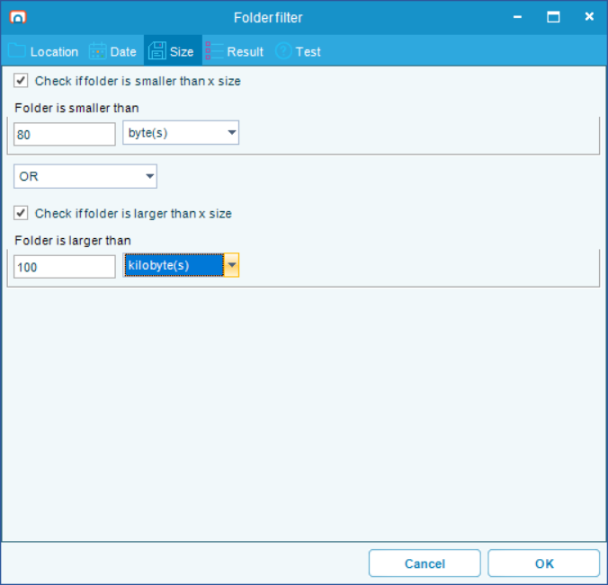

# Wildcard Matching

## What is it?

Several OpCon RPA fields match a value against a pattern rather than against an exact string. A pattern can contain wildcard characters, which stand in for parts of the value that change from run to run — a window title that includes today's date, an element whose text includes a record number, or a file whose name includes a sequence number.

Wildcard matching is used wherever OpCon RPA has to find something by name at runtime. A character means the same thing in every field that accepts it, and every field listed on this page accepts the whole set.

## Fields that support wildcards

Only the fields listed here interpret wildcards. Every other field is matched literally, so a `*` entered anywhere else is treated as an asterisk.

### Robot Task activities

Every activity that acts on a window or a control has a **Find Element** group of properties. Two of them accept wildcards.

| Property | Matched against | Wildcards | Default |
|---|---|---|---|
| **WindowTitle** | The title of the window the activity acts on | Yes | `*`, which matches any window |
| **Text** | The visible text of the control the activity acts on | Yes | Empty, which matches any text |
| **Name** | The control's accessible name | No — matched literally | Empty |
| **ClassName** | The control's window class | No — matched literally | Empty |
| **AutomationId** | The control's automation identifier | No — matched literally | Empty |
| **ProcessName** | The name of the process that owns the window | No — matched literally | Empty |

Activities that act on a whole window rather than on a control — **Attach Window**, **Close Window**, **Maximize Window**, and the rest — carry a **Title** property instead of **WindowTitle**, and have no **Text**. **Title** accepts the same wildcards, with the difference described in [Window titles and element text](#window-titles-and-element-text).

### File and folder filters

A file filter is used by the **Scan Document** action, by the **Upload file** step of a Web Macro, and by the **Get Files** and **Archive - Compress** activities in a Robot Task. Four of its fields, on the filter's **Location** tab, accept wildcards.

| Field | Matched against | Wildcards accepted | Notes |
|---|---|---|---|
| **Folder** | Folder paths to search | All of them | A wildcard expands one folder level. See [Folder patterns](#folder-patterns) |
| **Exclude folder(s)** | The folders found by the search | All of them | Excludes each match from the result |
| **Include file mask** | Each file name found | All of them | Defaults to `*`, which selects every file |
| **Exclude file mask** | Each file name found | All of them | Applied only when **Use file exclusion** is selected |

Separate multiple entries in any of these fields with a semicolon: `*.pdf;*.tif`.

The **Get Folders** activity uses a folder filter instead, described in [Folder filters](#folder-filters).

Two options change how the masks behave:

- **Case sensitive**, in the **Include file mask** group, makes the **Exclude file mask** case-sensitive, and makes both masks case-sensitive when they are regular expressions. Cleared by default. It has no effect on a wildcard **Include file mask** or on **Folder**, which are always matched without regard to case
- **Is regex**, available separately for the include and exclude masks, replaces wildcard matching with regular expression matching for that mask. The wildcard characters below then no longer apply to it

:::note Corrected in 1.3.0: `#` and `[list]` in folders and the include mask
Starting in 1.3.0, `#`, `[list]`, and `[!list]` work in **Folder**, **Exclude folder(s)**, and **Include file mask**. In earlier versions those characters matched nothing in **Folder** and **Include file mask**, so a mask such as `statement-####.pdf` found no files. If you worked around that, for example with `statement-*.pdf` or a regular expression, the workaround still matches as before.

One pattern can now match more than it did. A `[` always starts a character list, so the mask `log[1].txt` matches `log1.txt` as well as a file literally named `log[1].txt`. Review any mask or folder path that contains a `[`.
:::

:::note Corrected in 1.2.0
Wildcard patterns are matched correctly starting in 1.2.0. In earlier builds the routine behind every field listed here reported no match for every pattern it was handed, so a field holding a wildcard generally found nothing at all rather than matching literally. A pattern that never matched before may now match, and a field you had worked around may now return more than you expect — review the patterns in your existing tasks after you update.
:::

### Folder filters

The **Get Folders** activity finds folders rather than files. Its settings are in the **Folder filter** window, which you open with the **Folder filter** button on the activity or the **Folder filter** property in the properties panel. Three fields on its **Location** tab accept wildcards.

| Field | Matched against | Wildcards accepted | Notes |
|---|---|---|---|
| **Base folder** | Folder paths to search | All of them | Expands one folder level, like **Folder** in a file filter |
| **Include folder mask** | The name of each folder found | All of them | Defaults to `*`, which selects every folder |
| **Exclude folder mask** | Each folder found | All of them | Applied only when **Use folder exclusion** is selected |

An **Exclude folder mask** entry with no `\` in it is compared with the folder's name, and an entry with a `\` is compared with its full path. If the field mixes the two kinds, every entry is compared with the folder's name, so keep to one kind per filter.

Each mask group has its own **Case sensitive** and **Is regex** options. **Case sensitive** is not applied consistently to wildcard masks, so do not rely on it to tell two folders apart by case alone.

#### Size conditions

The **Size** tab keeps or drops each folder by its total size. Select **Check if folder is larger than x size**, **Check if folder is smaller than x size**, or both. Enter a whole number in **Folder is larger than** or **Folder is smaller than**, and select a unit from **byte(s)** to **terabyte(s)**. When both conditions are selected, the operator between them decides whether a folder must meet both (**AND**) or either one (**OR**).

The size fields are validated when you select **OK**, and when you select **Show filtered folders** on the **Test** tab:

| Message | Cause |
|---|---|
| `Field 'Smaller than' must not be empty.` | The condition is selected but its field is empty |
| `Field 'Smaller than' must be a whole number.` | The field holds something other than digits, such as a sign, a decimal point, a separator, or a variable |
| `Field 'Smaller than' is too large for the selected unit.` | The number is too large to express in bytes for that unit. Enter a smaller number, or select a larger unit |

The same messages name **Larger than** for the other field. A condition that is not selected is not validated, whatever its field holds.

With **OR**, only the conditions you selected count. A folder passes when it meets one of them, so selecting only **Check if folder is larger than x size** keeps only the larger folders. With neither condition selected, every folder passes.

:::note Corrected in 1.3.0
The **Folder filter** window opens and saves again starting in 1.3.0. In earlier versions it failed to open, so a **Get Folders** activity could not be configured. A filter set to **OR** with only one size condition selected also let every folder through; it now keeps only the folders that meet that condition.
:::

### The FILE(Exists) variable

`{FILE(Exists|<path>)}` returns `True` when the file exists and `False` when it does not. A wildcard in the file name part of the path makes it return `True` when at least one file in that folder matches, for example `{FILE(Exists|C:\inbox\statement-####.pdf)}`. The form that takes a credential, `{FILE(Exists|<path>|<credential id>)}`, matches the same way.

- Every wildcard is accepted in the file name. Starting in 1.3.0 that includes `#`, `[list]`, and `[!list]`, which earlier versions answered with `False`
- Wildcards are not accepted in the folder part of the path, and subfolders are not searched
- The file name is matched without regard to case
- The form that takes a user name, password, and domain does not accept wildcards

## Supported wildcards

| Character | Matches | Pattern | Matches | Does not match |
|---|---|---|---|---|
| `*` | Zero or more characters | `Invoice*` | `Invoice`, `Invoice 4102 — Acme` | `Draft invoice` |
| `?` | Exactly one character | `Report?.pdf` | `Report1.pdf`, `ReportA.pdf` | `Report.pdf`, `Report10.pdf` |
| `#` | Exactly one digit, `0` to `9` | `Batch-####` | `Batch-0417` | `Batch-041`, `Batch-04AB` |
| `[list]` | Exactly one character from the list | `[ABC]-summary` | `A-summary`, `C-summary` | `D-summary` |
| `[a-z]` | Exactly one character in the range | `Ledger-[0-9][0-9]` | `Ledger-08` | `Ledger-8` |
| `[!list]` | Exactly one character **not** in the list | `[!0-9]*` | `Acme report` | `2026 report` |

Combine them freely. `Invoice ####-??.pdf` matches `Invoice 4102-AB.pdf`.

Every row works in every field listed in [Fields that support wildcards](#fields-that-support-wildcards).

## How matching works

Three rules govern every match.

- **Matching is not case-sensitive by default.** `invoice*` and `INVOICE*` behave identically, and both match `Invoice 4102`. Window titles, element text, folder paths, and a wildcard **Include file mask** are always matched without regard to case. The **Exclude file mask** follows the **Case sensitive** option on the filter, which is cleared by default.
- **The pattern must match the whole value, not part of it.** `Invoice` matches only the exact text `Invoice`. To match a title that merely contains the word, surround it with `*` — `*Invoice*`.
- **An exact match always wins.** A pattern identical to the value matches even when it contains wildcard characters, so a window genuinely titled `Report*` is still found by the pattern `Report*`. This comparison ignores case too.

:::tip Match the stable part of the value
Write the pattern around the part of the text that never changes, and use a wildcard for everything that does. A window titled `Acme Teller — Session 4102 — Connected` is best matched by `Acme Teller*`, not by `*4102*`, which stops working on the next run.
:::

## Window titles and element text

In a Robot Task, **WindowTitle**, **Title**, and **Text** are all matched as patterns. This matters for any application whose captions carry a value that changes: a record number, a customer name, a timestamp, or a document count.

A recorded value is captured literally, so a recording made against `Acme Teller — Session 4102` looks for exactly that title on the next run and fails when the session number changes. Edit the activity and replace the part that varies with a wildcard.

To make a recorded activity tolerant of a changing caption, complete the following steps:

1. Open the Robot Task and select the activity that fails.
2. Under **Find Element**, find the **WindowTitle**, **Title**, or **Text** property holding the value that changes.
3. Replace the changing part of the value with a wildcard — for example, change `Acme Teller — Session 4102` to `Acme Teller*`.
4. Save the task.
5. Run the task to confirm the activity now finds the window.

:::note Element text is matched together with the element's other properties
An activity finds a control by its **Text** and its **ClassName** and **AutomationId**. A wildcard widens the text comparison only — the candidate's class name and automation id are compared exactly.

Be aware that the comparison relaxes in stages if nothing is found. The activity first looks for a candidate whose text matches **and** whose class name **and** automation id both match. If none is found, it accepts a text match with **either** the class name **or** the automation id. If that fails too, it accepts a text match alone. A broad **Text** pattern can therefore still land on a control whose class name and automation id are both wrong, so keep the pattern as specific as the changing value allows.

Leaving **Text** empty is itself a wildcard: any text matches, and the control is chosen on **ClassName** and **AutomationId** alone.
:::

:::caution An over-broad pattern is not safe
For element location — an activity with a **WindowTitle** property — the first candidate that matches is used, and if a pattern is broad enough to match more than one, which one is found is not predictable.

For the window activities — an activity with a **Title** property — a pattern containing `*`, `?`, or `#` makes the activity act on **every** window it matches, not just the first. A **Close Window** with **Title** set to `*` closes every window the process owns. Keep the pattern as specific as the changing value allows: prefer `Invoice ####` over `Invoice*`.

A **Title** with no `*`, `?`, or `#` in it acts on a single window: the activity takes the first caption that matches it, rather than every match. The comparison is still made without regard to case.
:::

## Folder patterns

A wildcard in the **Folder** field of a file filter, or the **Base folder** field of a folder filter, expands one folder level at a time. Every wildcard expands a folder level.

| Pattern | Searches |
|---|---|
| `C:\data\inbox` | That folder only |
| `C:\data\*\inbox` | The `inbox` folder of every folder directly under `C:\data` |
| `C:\data\2026-??\inbox` | The `inbox` folder of `C:\data\2026-01`, `C:\data\2026-02`, and so on |
| `C:\data\batch#` | `C:\data\batch1`, `C:\data\batch2`, and so on, but not `C:\data\batch10` |
| `C:\data\branch[ABC]` | `C:\data\branchA`, `C:\data\branchB`, and `C:\data\branchC` |

**Exclude folder(s)** works differently: it does not expand anything. Each pattern is compared against the folders the search has already found, and the files in every folder that matches are dropped from the result.

That has a consequence worth knowing. The list of found folders is only built when **Folder** holds no wildcard, and a `[` counts as one, so a wildcard **Exclude folder(s)** pattern has no effect at all if **Folder** contains one. To search broadly and then carve out what you do not want, put the wildcard in the exclusion rather than in the search:

- **Folder** — `C:\data`
- **Include sub folders** — selected
- **Exclude folder(s)** — `C:\data\test*`

That searches every folder under `C:\data` except the ones whose name begins with `test`. A pattern with no wildcard in it, such as `C:\data\archive`, is excluded correctly whatever **Folder** contains.

:::note The path up to the first wildcard must exist
A folder pattern is expanded one level at a time, starting from the part of the path before the first wildcard. That part must be an existing folder. `C:\data\*\inbox` works when `C:\data` exists; a pattern whose fixed root does not exist matches nothing rather than reporting an error.
:::

## FAQs

**Which fields accept wildcards?**
The **WindowTitle**, **Title**, and **Text** properties of a Robot Task activity; the **Folder**, **Exclude folder(s)**, **Include file mask**, and **Exclude file mask** fields of a file filter; the **Base folder**, **Include folder mask**, and **Exclude folder mask** fields of a folder filter; and the file name in `{FILE(Exists|<path>)}`. See [Fields that support wildcards](#fields-that-support-wildcards). Every other field is matched literally.

**Can I use a wildcard in ClassName, AutomationId, or ProcessName?**
No. Those are matched literally. Only **WindowTitle**, **Title**, and **Text** interpret wildcards.

**Does `#` or `[list]` work in a file mask or a folder path?**
Yes, starting in 1.3.0. Earlier versions matched nothing for those characters in **Folder** and **Include file mask**. If a mask still finds nothing, select **Show filtered files** on the filter's **Test** tab to see what it matches.

**Why does my mask with square brackets match more files than before?**
A `[` starts a character list. Starting in 1.3.0 this applies to **Include file mask** and folder paths too, so `log[1].txt` matches `log1.txt` as well as a file named `log[1].txt`. To match only the literal name, select **Is regex** and escape the brackets: `^log\[1\]\.txt$`.

**Is matching case-sensitive?**
Not by default. Window titles and element text are always compared without regard to case, as are folder patterns and a wildcard **Include file mask**. For the **Exclude file mask**, select the **Case sensitive** option on the filter if you need case to matter.

**Why does my pattern not match a title that clearly contains the text?**
The pattern must match the whole value. Add `*` at each end — `*Invoice*` rather than `Invoice`.

**How do I match a value that really contains an asterisk or a question mark?**
Enter the value exactly as it appears. An exact match is checked before the pattern is interpreted, so a literal value matches itself.

**What is the difference between `?` and `*`?**
`?` stands for exactly one character; `*` stands for any number of characters, including none.

**Can I use a regular expression instead?**
Not in **WindowTitle**, **Title**, or **Text** — those accept wildcards only. A file filter has an **Is regex** option for the include and exclude masks, which replaces wildcard matching for that mask.

**My recorded task worked once and then stopped finding the window.**
The recorded title probably contains a value that changes between runs. Edit the activity and replace the changing part with a wildcard.

**Do wildcards work in a folder name in the middle of a path?**
Yes. `C:\data\*\inbox` is expanded one folder level at a time, and so is `C:\data\batch#\inbox`. The part of the path before the first wildcard must be an existing folder.

**Why can I not save my Get Folders size filter?**
The size fields accept a whole number only, with no variables, and the number must fit the unit you selected. The message names the field and the problem. See [Size conditions](#size-conditions).

**Can I test whether a file matching a pattern exists?**
Yes. `{FILE(Exists|C:\inbox\statement-####.pdf)}` returns `True` when at least one file in `C:\inbox` matches. See [The FILE(Exists) variable](#the-fileexists-variable).

## Related topics

- [Robot Task](./robot-task-rpa.md)
- [Unattended Session](./rpa-unattended-session.md)
- [Scan Document](./scan-document-task.md)

## Glossary

| Term | Definition |
|------|-----------|
| Wildcard | A character in a pattern that stands for other characters, so one pattern matches a family of values. |
| Pattern | The value you enter in a field that supports wildcards, compared against the value found at runtime. |
| File mask | The pattern a file filter compares against each file name to decide whether the file is selected. |
| Folder mask | The pattern a folder filter compares against each folder to decide whether the **Get Folders** activity returns it. |
| Character list | A set of characters in square brackets, such as `[ABC]` or `[0-9]`, that matches exactly one character from the set. `[!ABC]` matches one character not in the set. |
| Element text | The visible text of the control a Robot Task activity acts on, used together with the control's class and identifier to find it. |
