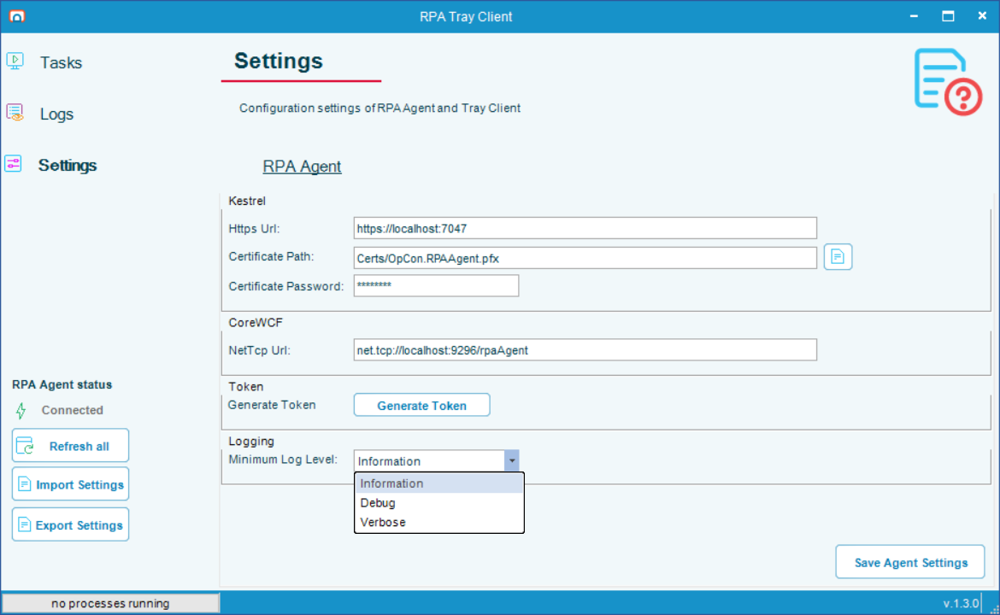

# Troubleshooting

## What is it?

This page documents known limitations of OpCon RPA desktop recording and playback, where each component writes its log and how to change how much it records, and the task failures that are caused by how a task or host is configured rather than by a defect. Use this page to confirm whether a behavior is expected before starting deeper troubleshooting.

For failures involving privileges, session unlocking, or sign-in, see [Permissions Troubleshooting](./rpa-permissions-troubleshooting.md), which maps Agent error messages to causes.

## Where the logs are

Every OpCon RPA component logs under one root on the host, `C:\ProgramData\Continuous\OpCon RPAAgent\Logs`, with a subfolder per component.

| Component | Subfolder | File name | Notes |
|---|---|---|---|
| RPA Agent service | `Agent` | `log<yyyymmdd>.txt` | Start here for anything about sessions, privileges, or dispatch |
| RPA Tray Client | `TrayClient\<username>` | `trayclient_log_<yyyymmdd>.txt` | One folder per signed-in user, since each session runs its own Tray Client |
| Background host process — Web Macro, Scan Document, and Robot Tasks that run in the background | `HeadlessRunner\<execution user>` | `headless-<yyyymmdd>.log` | One folder per account a task runs as, because the host process runs as that account. Its task log events are also forwarded to the Agent's log |

Each component starts a new file every day, and also when the current file reaches 50 MB: the next file of the day carries a suffix, for example `log<yyyymmdd>_001.txt`. Each folder keeps its 14 newest files and deletes older ones, so the Agent and each Tray Client folder stay below about 700 MB. The limit for the background host applies per execution user's folder.

A log line written while a task is running starts with `(task <task id>/proc <process id>)`, after the timestamp and level. The Agent log and the background host log both carry it, so searching for the process ID follows one run across both. Timestamps include milliseconds.

:::note ProgramData is hidden by default
`C:\ProgramData` does not appear in File Explorer unless hidden items are shown. Enter the path in the address bar to reach it.
:::

## Change the log level

By default every component records at the **Information** level. Raise the level to collect more detail when you are investigating a problem, then set it back.

To change the log level, complete the following steps:

1. In the RPA Tray Client, select **Settings** in the left menu.
2. On the **RPA Agent** tab, under **Logging**, select the **Minimum Log Level:** field and pick a level from the list.

   

   | Level | What it records |
   |---|---|
   | **Information** | The default. Task progress, results, warnings, and errors |
   | **Debug** | Adds step-by-step detail from the task runners |
   | **Verbose** | Adds the most detailed trace output. Use it only when Continuous support asks for it |

3. Select the **Save Agent Settings** button.

The RPA Agent and the Tray Client you saved from apply the new level immediately, with no restart. Background host processes started after the change use it as well. A Tray Client running in another user's session applies it after it reconnects to the Agent or after **Refresh all** is selected in it.

Debug and Verbose fill the 50 MB files faster, so older files are deleted sooner. To collect detail for one task only, select **Extended Task debug logging** in that task's **Output** settings instead; it raises the level for that task's runs alone.

## Known limitations

- The RPA desktop recorder takes full control of the host system in order to run the workflow.
  - A dedicated machine is preferred for running the playback of desktop RPA tasks, to ensure sufficient resources are available and that the recording and playback of tasks do not interfere with the management of other critical operations.
  - A Robot Task that runs in the background does not use the desktop, so it does not take control of the host this way.

- RPA desktop tasks can only support recording workflow on the host system on which the OpCon RPA Tray Client is installed.
  - The RPA desktop recorder does not currently support the ability to replay workflow recorded on a remote virtual machine.

## Background tasks have a runtime limit

A background task runs in its own host process, and that process is bounded. This applies to every Web Macro and Scan Document task, and to every Robot Task that runs in the background. The `HeadlessTaskMaxRuntimeMinutes` setting in `appsettings.json` ships set to **60** minutes; a task that exceeds it is failed with a timeout and its host process is terminated.

The limit exists because these tasks are dispatched one at a time. Without a ceiling, a single task that hung would hold the queue and every background task behind it would wait indefinitely.

| If you need | Do this |
|---|---|
| Longer than an hour for a legitimate task | Raise `HeadlessTaskMaxRuntimeMinutes` in `C:\Program Files\RPAAgent\appsettings.json` to a value comfortably above the longest task you expect |
| No limit at all | Set it to `0`. A hung task then blocks every background task behind it until an operator intervenes |

Two things follow from the tasks being dispatched serially. Two long background tasks scheduled to overlap will run one after the other, not together — so allow for that when you build the schedule. And the value is read when a task is dispatched, so changing it does not affect a task already running.

Robot Tasks that run in the foreground are not affected — they run through the interactive Tray Client rather than the background host. A Robot Task that has always run inside an hour as a foreground task is subject to the limit once it runs in the background.

## A background task ends Aborted because its run-as user cannot log on

The RPA Agent starts a background task's host process by logging the run-as user on to the host. It asks Windows for a batch logon first, and falls back to an interactive logon. When the account holds neither right, the task ends **Aborted** before it starts, and its result text names the account and both rights:

`Failed to launch headless runner host: LogonUser failed for both batch and interactive logon: '<user>' holds neither 'Log on as a batch job' nor 'Allow log on locally' on this machine (or a matching Deny policy overrides them). Grant one of those rights to the execution user. (errorcode=1385@LogonUser)`

The same text appears in the Agent's log, on the `Task failed` line for the run.

Grant the run-as user, or a group it belongs to, **Log on as a batch job** on the RPA host, and make sure no **Deny log on as a batch job** or **Deny log on locally** policy applies to it. Either right is enough, but **Log on as a batch job** is the better one to grant, because the run is then recorded in the Windows security log as a batch logon. Windows grants **Allow log on locally** to ordinary users by default, so this failure usually means a policy removed it or a Deny policy applies. In a domain, check the Group Policy that sets User Rights Assignment, because it overrides a local change.

## A Robot Task runs in the wrong mode

A Robot Task runs in the background only when its **Force foreground** option is cleared and every activity is background-safe. See [Background and foreground execution](./robot-task-rpa.md#background-and-foreground-execution).

| Symptom | Cause | What to do |
|---|---|---|
| A task you expected to run in the background runs in the foreground | The task was saved before 1.3.0, so it counts as **Force foreground** selected | Clear **Force foreground** in its Execution Context and publish it again. See [Let an existing task run in the background](./robot-task-rpa.md#let-an-existing-task-run-in-the-background) |
| A task you expected to run in the background runs in the foreground | An activity needs the desktop, or the task plays back in Map mode | Read the indicator above the workflow designer on the **Robot** tab. It names the activity or setting |
| A task you expected to run in the background runs in the foreground | `RouteBackgroundRobotTasks` is `false` in the Agent's `appsettings.json` | Set it to `true`. See [Turn off background execution for Robot Tasks on an Agent](./robot-task-rpa.md#turn-off-background-execution-for-robot-tasks-on-an-agent) |
| A task you expected to run in the background runs in the foreground | The OpCon job runs a specific version of the task, published before the change | Set the job to the new version, or to use the latest version |
| A task runs in the background but needed the desktop, or fails because a session it relied on is missing | The task relies on something outside its own activities, such as a session or an application that another task in the job opened | Select **Force foreground** on the task. See [When to select Force foreground](./robot-task-rpa.md#when-to-select-force-foreground) |

To confirm which way a run went, search the Agent log for the task ID. A run sent to the background host is recorded with a line saying the task `is routed to the headless runner host instead of an interactive RPA Client session`.

## A Robot Task fails because no RPA Client was found for its user

A Robot Task that runs in the foreground is started only in a session that belongs to its own execution user, through the Tray Client in that session. When no such session exists, the task fails to start with:

`RPA Client for execution user '<user>' was not found: no interactive session with a live RPA.TrayClient is registered for that user. ... Connected client sessions: <sessions>.`

The list of connected sessions at the end shows whether any Tray Client is connected at all, and whose. A session belonging to a different user is never used in place of the execution user's own.

To resolve it, do one of the following:

- Give the task an RDP login user, so OpCon signs the account in for each run. See [Unattended Session](./rpa-unattended-session.md)
- Have the account signed in on the host, with its Tray Client running
- If the task needs no desktop, let it run in the background, where no session is needed. See [Background and foreground execution](./robot-task-rpa.md#background-and-foreground-execution)

## A Web Macro or Scan Document task fails with no execution user

A Web Macro or Scan Document task runs in its own host process with no interactive session. That process is never run as Local System, and there is no fallback to the interactive RPA Tray Client. A task with no execution user therefore fails before it starts, reporting that the task has no execution context and no identity to run as.

An RPA Tray Client signed in on the host does not rescue the task: with no execution user there is nothing to match a client against, so the task would run as whichever user happened to be registered first. It fails instead of running as an arbitrary identity.

To resolve it, open the task, set an execution user, and save it. Saving is what writes the value, so a task authored on an earlier version has to be saved once even if nothing about it looks changed.

This affects every installation, so an existing task can start failing on a host that has not otherwise changed. See [Update - OpCon RPA Agent and ACS plugin](./update-opcon-rpa.md#120).

## A task is refused on a Background only Agent {#a-task-is-refused-on-a-background-only-agent}

When an Agent installed in Background only mode receives a task it cannot run, it does not start it. The task ends with the status **Aborted** within seconds, and the reason is recorded as the task's result text. Every reason starts with `This Agent is installed in Background only mode`. For what such an Agent runs, see [Background only Agent mode](./rpa-background-only-mode.md#what-a-background-only-agent-runs).

The Agent checks for a foreground Robot task before it checks for a run-as user, so a task that has both reports Force foreground first.

**Force foreground is selected, or the Robot task was saved before 1.3.0:**

> This Agent is installed in Background only mode, which runs background tasks only. This Robot task runs in the foreground: Force Foreground is checked, or the task was saved before that setting existed, which counts as checked. To fix it, open the task in the RPA Client editor and save it: saving on this Agent turns Force Foreground off, and the task then runs in the background if none of its activities needs a desktop. Saving a published task stores it as a new version: an OpCon job set to Use latest runs the new version from its next run, but a job set to a specific version keeps running this one until the job's version is changed. Or run the task on an Agent installed in Full mode.

To fix it, open and save the task on this Agent. See [Clear a run-as user or Force foreground from a task](./rpa-background-only-mode.md#clear-a-run-as-user-or-force-foreground-from-a-task).

**An activity in the Robot task needs a desktop:**

> This Agent is installed in Background only mode, which runs background tasks only. This Robot task needs an interactive desktop (first activity that needs one: *activity*), so it cannot run here. Run it on an Agent installed in Full mode.

Replace the activity with a background-safe one, or run the task on a Full Agent.

**The Robot task's activities could not be checked:**

> This Agent is installed in Background only mode, which runs background tasks only. This Robot task's activities could not be checked for background safety (*detail*), so it cannot run here.

Open the task in the editor and save it again. If the message persists, run the task on a Full Agent.

**The task has a run-as user:**

> This Agent is installed in Background only mode, which runs every task as the Agent's own service account. This task has a run-as user set ('*user*'), and this Agent cannot run a task as another user. To fix it, open the task in the RPA Client editor and save it: saving on this Agent removes the run-as user (Remove next to it under Execution Context does the same before you save). The stored credential is not deleted. Saving a published task stores it as a new version: an OpCon job set to Use latest runs the new version from its next run, but a job set to a specific version keeps running this one until the job's version is changed. Or run the task on an Agent installed in Full mode.

When the stored name cannot be decrypted on this machine, the message reads `This task has a run-as user set (its stored name cannot be read on this machine).` instead. The fix is the same. See [Clear a run-as user or Force foreground from a task](./rpa-background-only-mode.md#clear-a-run-as-user-or-force-foreground-from-a-task).

**The task's stored definition cannot be read:**

> This Agent is installed in Background only mode, and this task's stored definition could not be read, so it cannot be checked for a run-as user. Open the task in the editor and save it again. Saving a published task stores it as a new version: an OpCon job set to Use latest runs the new version from its next run, but a job set to a specific version keeps running this one until the job's version is changed.

## The Agent does not start because its mode and service account do not match {#agent-does-not-start-mode-mismatch}

The Agent checks its Agent mode against its service account every time it starts. This usually goes wrong after a mode change, when an old `appsettings.json` is copied over the new one, or when the service account is changed by hand. When they do not match, the service stops, and the Agent writes the reason to the Windows **Application** event log with **Event ID 2602** and the source **RPA.Agent**. If that source cannot be created, the event is written with the source **.NET Runtime** and the message starts with `RPA.Agent:`. The same message is the last line of the Agent log.

| Message starts with | Cause | What to do |
|---|---|---|
| `The Agent will not start: it is configured as BackgroundOnly ("AgentMode" in appsettings.json) but is running as LocalSystem` | `appsettings.json` says Background only, but the service runs as Local System. Usually a Background only `appsettings.json` was copied onto a Full install | Set `"AgentMode": "Full"` in `appsettings.json` and start the service. To make the Agent Background only, [change its mode](./rpa-background-only-mode.md#switch-modes) |
| `The Agent will not start: it is configured as BackgroundOnly ("AgentMode" in appsettings.json) but is running as another account` | `appsettings.json` says Background only, but the service account was changed by hand to an account other than Local System or `NT SERVICE\RPA.Agent` | Set the service account back to `NT SERVICE\RPA.Agent`, or reinstall |
| `The Agent will not start: it is in Full mode but is running as` | The service account was changed by hand, or the `AgentMode` setting was removed from a Background only install, for example by copying an older `appsettings.json` over it | If `sc qc RPA.Agent` shows `NT SERVICE\RPA.Agent`, set `"AgentMode": "BackgroundOnly"` in `appsettings.json`. Otherwise, set the service back to Local System, or reinstall |
| `The Agent will not start: "AgentMode" in appsettings.json is` | The `AgentMode` value is not `Full` or `BackgroundOnly` | Correct the value. An absent or empty value means Full |
| `The Agent will not start: it is BackgroundOnly and cannot use the private key of the HTTPS certificate` | `appsettings.json` names your own HTTPS certificate by thumbprint, and the service account cannot read its private key | Grant `NT SERVICE\RPA.Agent` **Read** on the certificate's private key, or repair the RPA Agent install, which grants it for the configured thumbprint |

## FAQs

**Why does a long background task fail after about an hour?**
It has hit the runtime limit on background tasks, which ships at 60 minutes and applies to Web Macro, Scan Document, and background Robot Tasks. See [Background tasks have a runtime limit](#background-tasks-have-a-runtime-limit).

**Why did a Web Macro or Scan Document task that used to run stop running after the update to 1.2.0?**
It probably has no stored execution user. Open the task, set an execution user, and save it — saving is what stores the value, and earlier versions never stored one for these task types. See the [options above](#a-web-macro-or-scan-document-task-fails-with-no-execution-user).

**Do I need to restart anything after changing the log level?**
No. The Agent and the Tray Client you saved from apply it immediately. See [Change the log level](#change-the-log-level).

**Why are there several log files for the same day?**
A file that reaches 50 MB rolls over to a new file with a numbered suffix. Each folder keeps its 14 newest files. See [Where the logs are](#where-the-logs-are).

**Can I record an RPA desktop task on one machine and replay it on another virtual machine?**
No. The RPA desktop recorder does not currently support replaying workflow recorded on a remote virtual machine. Recording and playback must occur on the host system on which the OpCon RPA Tray Client is installed.

**Should I use a dedicated machine for OpCon RPA playback?**
A dedicated machine is preferred. The RPA desktop recorder takes full control of the host system, so dedicating a machine helps ensure sufficient resources and prevents the recording and playback from interfering with other critical operations. A dedicated host is also the compensating control recommended for the two Windows security policies OpCon RPA requires. See [Security Settings](./rpa-security-settings.md).

## Related topics

- [Permissions Troubleshooting](./rpa-permissions-troubleshooting.md)
- [Service Accounts and Permissions](./rpa-permissions.md)
- [Robot Task](./robot-task-rpa.md)
- [Background only Agent mode](./rpa-background-only-mode.md)
- [Task Types](./task-types-overview.md)
- [Unattended Session](./rpa-unattended-session.md)

## Glossary

| Term | Definition |
|------|-----------|
| Background host process | The process the RPA Agent starts as a task's execution user to run a Web Macro, a Scan Document task, or a Robot Task that runs in the background. |
| Minimum log level | The least severe level a component records. Lines below it are not written. |
| Correlation prefix | The `(task <task id>/proc <process id>)` text at the start of every log line written for a task run. |
