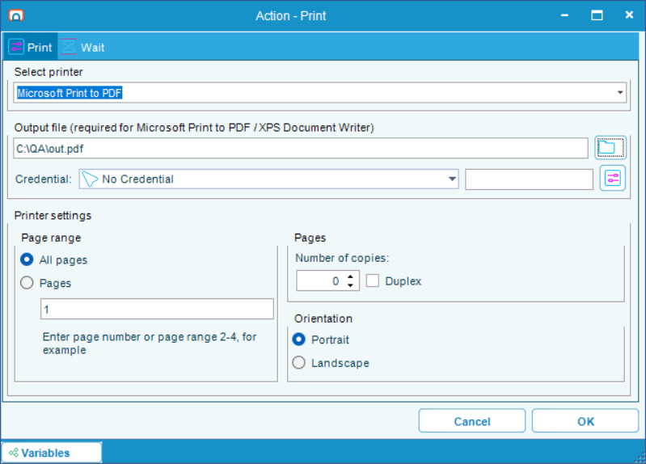

# Web Macro

## What is it?

A Web Macro task automates a process that happens in a web browser. You record yourself working through the process in an embedded browser, and RPA captures each interaction as a step. Playing the task back repeats those steps against the same pages.

Because the task drives its own browser rather than one on somebody's desktop, it does not need a signed-in Windows session. It can run on a host where nobody is logged in.

It does need a Windows account to run *as*: the execution user set on the task. A task with no execution user fails, so set an Execution Context on the task. The task editor prompts you with the **Execution Context Required** window when it is missing — see [Task Types](./task-types-overview.md).

On an Agent installed in Background only mode, the task runs as the Agent's own service account instead and has no execution user: saving the task on that Agent removes one. See [Background only Agent mode](./rpa-background-only-mode.md).

:::note Web Macro or Robot Task?
Use a Web Macro when the process happens entirely in a browser. It targets page elements directly, which survives the page moving or resizing, and it needs no desktop session.

Use a [Robot Task](./robot-task-rpa.md) when the process also involves Windows applications, or when it has to drive the user's own browser rather than an embedded one.
:::

## How a task is built

Most of a Web Macro is recorded rather than assembled by hand.

1. Open the task and select the **Web macro** tab, then the **Actions** tab.
2. Select **Record**. The **Web recorder** window opens.
3. Enter the starting address in the recorder's address bar, then work through the process. Each interaction becomes a step.
4. Select **Stop**, then answer **Yes** to "Do you want to save the recorded actions?".
5. Review the steps on the **Actions** tab, adjust individual steps as needed, and save.

The steps appear as a sequence you can reorder, disable, or edit — right-click a step for **Edit action** and **Disable**.

:::warning Recording replaces the existing actions
Recording is not additive. When you save a recording, the actions you just recorded replace everything the task had before — the recorder always starts from an empty sequence. To extend a task, edit its existing steps rather than re-recording, or record the whole process again from the start.
:::

### What recording captures on its own

Simply working through the process records these:

| What you do | Step recorded |
|---|---|
| Select something on the page | **Click element** |
| Type into a field | **Populate field** |
| Choose from a list | **Select element** |
| Select an option | **Check element** |
| Copy or cut a value | **Copy value** |
| Go to an address | **Navigate to URL** |
| Open, switch, or close a tab | **Create tab**, **Change tab to '…'**, or **Close tab '…'** |
| Save a file the page offers | **Download file** |
| Choose a file in an upload prompt | **Upload file** |
| Answer a browser sign-in prompt | **Authenticate** |
| Answer a page's own message or confirmation | **Respond to JS dialog** |

### What you add deliberately while recording

Some steps have nothing to observe, so you ask for them from the recorder's menu — right-click the page, or use the toolbar. The menu names them after the action to add rather than after the step:

| Menu item | Step recorded |
|---|---|
| **Add Screenshot action** | **Take screenshot** |
| **Add Print action** | **Print page** |
| **Add Save Source action** | **Save page source** |
| **Add Copy Link Address action** | **Copy link** |
| **Add Extract Data action** | **Extract data** |
| **Add Extract Table action** | **Extract table** |
| **Add Proxy action** | **Set proxy settings** |
| **Add Inject JS action** | **Inject JS script** |

**Add Copy Link Address action** and **Add Extract Data action** act on a particular element, so right-click the element you want first, then choose the action.

:::caution Add these from the recorder, not the toolbox
**Check element** and **Set proxy settings** have no settings window, and a Web Macro has no properties panel either, so a step you drag in from the toolbox cannot be configured at all — selecting **Edit action** on one does nothing. Record these steps instead of adding them by hand.

**Authenticate** is not in the toolbox at all. Recording is the only way to get one, and a recorded **Authenticate** step cannot be edited afterwards either — to change it, record that part of the process again.
:::

## How a step finds its element

Every step that acts on the page has a **Source** tab with three ways to identify the element. Recording fills this in for you; you edit it when a step stops finding its target.

| Mode | You provide | Use when |
|---|---|---|
| **Relative** | **Element path:**, and **Frame path:** if the element is inside a frame | The default, and what recording produces |
| **By search** | **Selector:**, **Attribute:**, **Regex value:**, and **Position:** | The element has no stable path but does have recognizable content |
| **By position** | **X:** and **Y:** | Nothing else identifies it. Fragile — the page must lay out identically every time |

**By search** finds every element matching the selector, keeps those whose chosen attribute matches your expression, and takes the one at **Position:** — **First**, **Last**, or **Specific** with an index you type. The attribute list offers the common ones (`innerText`, `innerHTML`, `outerText`, `outerHTML`, `id`, `class`, `style`, `href`, `target`, `title`, `type`, `name`, `value`), and you can type any other attribute name.

:::caution By search does not look inside frames
**By search** only searches the main document. If your element is inside a frame, use **Relative** with **Frame path:** set.

**By position** is only offered on **Click element**, **Download file**, and **Key event**. On every other step type the option is greyed out.
:::

## Waiting

Waiting is the single most common cause of a task that works while you watch it and fails when it runs unattended. There are two controls per step, on two different tabs.

| Control | Where | What it does | Default |
|---|---|---|---|
| **Wait element** and its timeout | **Source** tab | Waits for the element to appear before acting. On by default, 60 seconds | On, 60 seconds |
| **Allow to ignore the element** | **Source** tab | Continues instead of failing if the element never appears | Off |
| **Wait before execute:** and **Wait after execute:** | **Wait** tab | Fixed pauses either side of the step, in milliseconds | 500 each. Recorded tab steps come out at 2000 before, 0 after |

RPA also waits for the page to finish loading before each step acts, for up to a minute. That is automatic.

:::note The fixed pauses are milliseconds, and they add up
**Wait before execute:** and **Wait after execute:** default to 500 milliseconds each, and the fields do not say what unit they use. A forty-step recording therefore spends about forty seconds waiting even when every page responds instantly.

To change them across a whole task rather than step by step, use **Set wait for all actions** on the **Actions** tab. Prefer lowering the fixed pauses and relying on **Wait element**, which waits only as long as it needs to.
:::

## Getting data out

Four steps write a value into a variable:

| Step | What it saves | Where you name the variable |
|---|---|---|
| **Extract data** | One attribute of one element | **Destination** tab, under **Save to** |
| **Copy link** | The link address of the element | **Variable** tab, under **Save to** |
| **Save page source** | The page's HTML | **Variable** tab, under **Save to** |
| **Download file** | The path of the saved file | **Variable** tab, under **Local download path Variable** |

You name the variable yourself — there is no automatic naming. Type a new name or pick an existing one from the list.

**Copy value** does not write a variable. It records the value it copied for a later **Paste** step, and its **Copy** tab shows that value with a **Mask value** button for anything sensitive.

**Extract table** works differently: it walks a repeating structure or an HTML table, optionally across several pages, and writes the result as delimited text to a file or to the task's output rather than to a variable. You name its columns yourself under **Data column name:** and **URL column name:**.

:::note Mostly user variables
**Extract data**, **Save page source**, and **Download file** write user variables only — the scope picker is collapsed to a fixed **User Variable** label, and a task that previously specified a job variable has its key carried over to the user variable when you open the step.

**Copy link** is the exception: it still offers a **Variable type:** choice of **User Variable** or **Job Variable**.
:::

## Steps that write files

**Take screenshot**, **Print page**, **Download file**, and **Extract table** can write a file. **Take screenshot** and **Print page** fail when their file cannot be written, so a run that reports success has produced the file. **Download file** and **Extract table** fail when their credential cannot be used; see [Credentials on file steps](#credentials-on-file-steps).

### Print page

**Print page** sends the current page to a printer installed on the host. You set it up in the **Action - Print** window: select the printer under **Select printer** on the **Print** tab, then set the copies, orientation, and page range as needed.

A printer that saves to a file instead of paper, such as Microsoft Print to PDF or Microsoft XPS Document Writer, needs an output file, because nobody is present to answer its **Save As** prompt during a run. Enter the file in the **Output file (required for Microsoft Print to PDF / XPS Document Writer)** group, or select the browse button beside it.

| Setting | What to know |
|---|---|
| Output file | Must be a full path, such as `C:\Output\statement.pdf` or `\\fileserver\statements\statement.pdf`. Variables are accepted. The window will not save the step while a file-saving printer has no output file: it reports `Printer '<name>' writes to a file. Set the output file on the Print step.` |
| **Credential:** | Used only to write the output file to a network share. A file in a local folder is still written as the account the task runs as |
| **Number of copies:** and the page range | Variables are accepted. An empty **Number of copies:** prints one copy |

The step waits for the printer to finish, for up to 10 minutes, and then for the output file to be complete, so a later step never reads a partial file. When it succeeds, the task output shows `Printed page to '<file>' (<size> bytes)`, or `Printed page to '<printer>'` for a paper printer.

The step fails, with the reason in the task output, when:

- the printer is not installed on the host: `Printer '<name>' is not installed on this machine`
- the output file is not a full path
- the print job fails, is canceled, or does not finish within 10 minutes
- the output file cannot be written: `Cannot write print output file '<file>' as <account>: <reason>`. When the step has no credential, the message also suggests setting one

### Take screenshot

**Take screenshot** saves an image of the page to the **Folder:** and **File name:** on its **Screenshot** tab. If the file cannot be saved, for example because the account has no access to the folder, the step fails with `Could not save screenshot to '<path>': <reason>`.

The task output records what happened to the file: `Saving screenshot to '<path>': successful`, or `Saving screenshot to '<path>' skipped: the file exists` when **Overwrite options:** tells the step to keep an existing file.

### Credentials on file steps

**Take screenshot**, **Print page**, and **Save as PDF** each have a **Credential:** field for writing to a folder the task's own account cannot reach, typically a network share. **Download file** has one too. When **Force download** is selected, as it is on every recorded Download step, the browser engine writes the file to its destination itself, so also grant the destination folder to the account the task runs as. **Upload file** reads its files through a file filter, which has a credential of its own.

If a step's credential cannot be used, for example because its password has changed or the account no longer exists, the step fails. It does not carry on as the account the task runs as. The message names the credential and the reason, for example `Could not impersonate credential with id '<id>' for '<path>': <reason>`. The same applies to **Upload file**, to **Extract table** when it writes to a file, and to the **Show filtered files** preview on a file filter's **Test** tab, which reports the error instead of listing files as the editing user.

:::note Credentials on a Background only Agent
On an Agent installed in Background only mode, every task runs as the Agent's service account and a step credential is used for network access only. See [Background only Agent mode](./rpa-background-only-mode.md).
:::

## Clicks that open a new tab or window

A browser only opens a new tab for a click it believes a person made, so a recorded click on such a link needs to be replayed as real mouse input rather than a scripted one. A click seen to open a window is always replayed that way; beyond that, the recorder's **Force native clicks** option decides whether every other recorded click is too. A task you create in 1.2.0 starts with it on.

This has its own page — see [Native Clicks in Web Macros](./web-macro-native-clicks.md).

## Troubleshooting

| Symptom | Cause | What to do |
|---|---|---|
| A step fails reporting the element was not found | The page changed, or the step's identification no longer matches | Open the step's **Source** tab. Try **By search** with a stable attribute, or correct the element path |
| A click appears to do nothing on playback | The click needed to be a native click | See [Native Clicks in Web Macros](./web-macro-native-clicks.md) |
| The task works when you watch it but fails unattended | Timing — a page is slower without a person pausing between actions | Confirm **Wait element** is on for the failing step and raise its timeout, rather than raising the fixed pauses |
| A step inside a frame is never found | The step uses **By search**, which ignores frames | Switch to **Relative** and set **Frame path:** |
| A task runs far slower than the process takes by hand | The default fixed pauses on every step | Lower them with **Set wait for all actions** |
| A long-running task fails at the same point every time, about an hour in | The runtime limit on background tasks | See [Background tasks have a runtime limit](./troubleshooting-opcon-rpa.md#background-tasks-have-a-runtime-limit) |
| Playback acts on the wrong tab, or a pop-up breaks the run | The task predates 1.2.0, or the page opens and closes windows in a way the recording did not capture | Browser tabs were only modelled properly in 1.2.0, so re-record a task made on an earlier version. If the task was recorded on 1.2.0, check the tab steps against what the page actually does — a page that opens a window and closes it again can leave a step that closes the wrong tab. Delete or disable that step, or record that part again |
| A **Print page** step fails with `Printer '<name>' writes to a file. Set the output file on the Print step.` | The printer saves to a file, such as Microsoft Print to PDF, and the step has no output file | Open the step and enter a full path in the **Output file** group. See [Print page](#print-page) |
| A step that saves or reads a file fails with `Could not impersonate credential with id '…'` | The step's credential cannot sign in, for example because its password changed | Update the credential's password, or select a different credential on the step. See [Credentials on file steps](#credentials-on-file-steps) |
| A **Take screenshot** or **Print page** step that used to succeed now fails | The step now fails when its file is not written. Earlier versions reported success with no file | Read the reason in the task output, which names the file. Grant the account access to the folder, or set a **Credential:** on the step for a network share |
| A step cannot be edited — **Edit action** does nothing | **Check element**, **Set proxy settings**, and **Authenticate** have no settings window, and a Web Macro has no properties panel | Delete the step and record that part of the process again |

## FAQs

**Does a Web Macro need a signed-in user?**
No. It runs in its own host process with no interactive session. It does need an account to run as — its execution user, or the Agent's service account on a Background only Agent. See [Unattended Session](./rpa-unattended-session.md).

**Which browser does it use?**
An embedded browser that ships with OpCon RPA. It does not drive Chrome, Edge, or Firefox on the desktop, which is why it can run with nobody signed in. Its worker processes appear in Task Manager as `RPA.WebMacro.exe`.

**Can I edit a recording rather than starting over?**
Yes — steps can be reordered, disabled, and edited individually. You cannot *add* to a recording by recording again, though: a saved recording replaces the whole sequence.

**Can it sign in to a site?**
Yes. Typing credentials is recorded like any other typing, and a browser sign-in prompt is recorded as an **Authenticate** step. Use a masked value or an RPA credential rather than putting a password in a recorded field.

**Can it handle a site that opens pop-ups?**
Usually. Tab and window handling is recorded, and clicks that open windows are replayed as real mouse input. Review the recorded tab steps before relying on the task, and test it end to end — a page that opens and closes windows on its own is the case most likely to need a step adjusted. See [Native Clicks in Web Macros](./web-macro-native-clicks.md).

**Can it read a table off a page?**
Yes, with **Extract table**, which can follow pagination. Its output goes to a file or the task output rather than to a variable.

**Can a Web Macro print a page to PDF?**
Yes. Add a **Print page** step, select Microsoft Print to PDF, and enter a full path in the step's output file. See [Print page](#print-page).

**Can a step save a file to a network share?**
Yes. Set a **Credential:** on the step that has access to the share. The credential is used for the network share only. See [Credentials on file steps](#credentials-on-file-steps).

**Why is my task so slow?**
Almost always the per-step fixed pauses, which default to 500 milliseconds before and after every step.

## Related topics

- [Native Clicks in Web Macros](./web-macro-native-clicks.md)
- [Task Types](./task-types-overview.md)
- [Robot Task](./robot-task-rpa.md)
- [Unattended Session](./rpa-unattended-session.md)

## Glossary

| Term | Definition |
|------|-----------|
| Web Macro | An OpCon RPA task type that automates a process in a web browser, built by recording against an embedded browser. |
| Step | One recorded interaction in a Web Macro, such as a click or a field entry. |
| Element path | The recorded route to an element on the page, used by the **Relative** identification mode. |
| Frame path | The route to a frame within the page, when the target element sits inside one. |
| Native click | A click replayed as real mouse input, which a browser treats as an action by a person. |
| Output file | The file a **Print page** step writes when its printer saves to a file instead of paper, such as Microsoft Print to PDF. |
